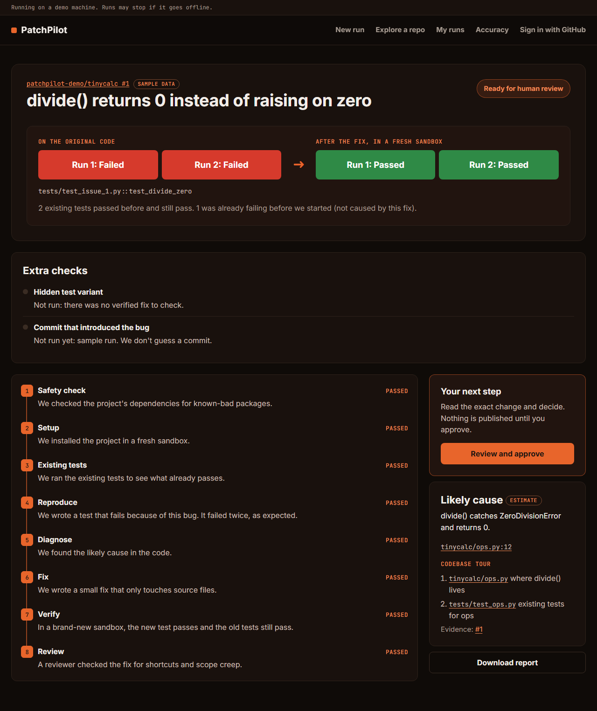
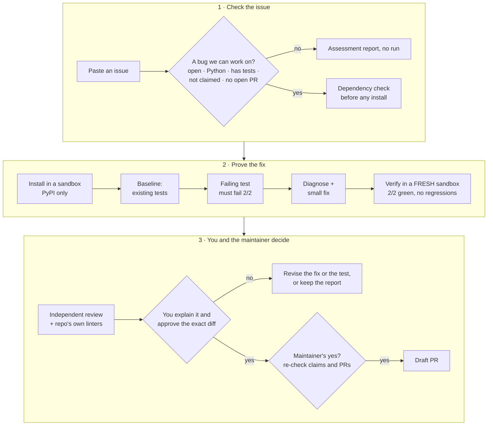

<div align="center">

# PatchPilot

**Turn a GitHub issue into a tested fix, with proof you can check.**

Paste an issue from a public Python project. PatchPilot reproduces the bug in a locked-down sandbox, writes a fix,
and shows you the same test **failing twice on the original code and passing twice after the fix**, in a brand-new sandbox.
Then *you* explain the change in your own words, approve the exact diff, and open a draft pull request only once a
maintainer has said yes (or you record why you're going ahead).

**[Try the read-only showcase →](https://patchpilot-demo.vercel.app)** (real recorded runs, nothing to install)

[Run it locally](#run-it-locally) · [How it works](#how-it-works) · [What's real](#whats-real-today) · [Known limits](#known-limits) · [Safety](#safety)

<sub>AgentX Hackathon 2026 · PS-05: bug-fix agent for code repositories</sub>

</div>

<p align="center">
  
  <br><sub>A finished run (sample data, labelled as such in the app). Red twice on the original code, green twice after the fix.</sub>
</p>

---

## Proof from real runs

### A real open-source contribution

[**wheelgap/wheelgap#133**](https://github.com/wheelgap/wheelgap/pull/133) fixes
[wheelgap#114](https://github.com/wheelgap/wheelgap/issues/114) (`--online` sent private-index package names to public
PyPI), in a project we don't control. PatchPilot did the intake, reproduction, fix, verification and PR; a person
approved it, answered the three ownership questions, and added the CHANGELOG line.

- **Maintainer review:** "This looks good overall… the right shape, and the tests cover both lockfile formats."
- **The maintainer raised three points.** Two of them PatchPilot's Reviewer had already flagged, but they weren't fixed
  before publishing. All three are addressed in a follow-up commit, which passes the repo's own CI checks (pytest, ruff
  check, ruff format, mypy).
- **Status:** open and awaiting the maintainer's re-review. It isn't merged, and we don't claim it is.

### Planted bugs

PatchPilot opened these draft pull requests on [`Niranjan-cyber/tinycalc`](https://github.com/Niranjan-cyber/tinycalc),
a small public demo repo with three planted bugs. Each one was reproduced, fixed and verified end to end, then approved by a person before it was opened:

| Issue | Draft PR opened by PatchPilot |
|---|---|
| [#1](https://github.com/Niranjan-cyber/tinycalc/issues/1) `divide(x, 0)` returns 0 instead of raising | [#4](https://github.com/Niranjan-cyber/tinycalc/pull/4) |
| [#3](https://github.com/Niranjan-cyber/tinycalc/issues/3) `parse_number("1,000")` crashes | [#5](https://github.com/Niranjan-cyber/tinycalc/pull/5) |
| [#2](https://github.com/Niranjan-cyber/tinycalc/issues/2) `mean([])` returns 0 instead of raising | [#6](https://github.com/Niranjan-cyber/tinycalc/pull/6) |

Each PR contains the new test and the fix. A person reviewed the exact diff before it was published, and nothing was merged automatically.

## Why it's different

| Principle | What it means |
|---|---|
| **Proof, not promises** | A fix counts as verified only when a new test fails 2/2 on the original code and passes 2/2 after the fix, in a fresh container, with every previously passing test still passing. |
| **Honest when it can't** | If it can't verify a fix, you get a triage report (the reproduction, the likely cause, what was tried), never a fake "fixed". |
| **Code decides, not the AI** | AI roles only *propose*. Every status, gate and outcome is computed by code ([`docs/contracts.md`](docs/contracts.md)). |
| **A human always decides** | Draft PRs only, after you approve the exact diff. If the diff changes, the approval is cancelled. |
| **You own the change** | Before approving, you answer three questions in your own words: what was broken, why the fix works, and what the test proves. The answers stay in your report, never in the PR. |
| **Maintainers come first** | No PR without a maintainer's yes (a reply, a "help wanted" label, or an invitation in CONTRIBUTING), or a reason you type, which is labelled as an override. PatchPilot asks at most once, honours a "no", and checks for other people's claims and PRs at the start and again just before publishing. |
| **Friendly to first-time contributors** | Plain-language steps, a short tour of the files that matter, and answers to "why does this test fail?" that cite their evidence. |

## How it works



Every arrow is a gate (G0–G6) evaluated by code. A step that can't finish stops the run with a reason. Failures are never shown as empty.

## Run it locally

You can explore the app with **sample runs and no keys at all**. To fix real issues you need one free AI key.

### 1. Prerequisites

| Tool | Version | Why |
|---|---|---|
| [Docker](https://docs.docker.com/get-docker/) (Desktop on Windows/macOS) | running | every run happens in sandboxes |
| Python | 3.12+ | API and worker |
| [uv](https://docs.astral.sh/uv/) | recent | Python dependencies |
| Node.js | 20+ | builds the web app |

Tested on Windows 11 with Docker Desktop.

### 2. Install

```bash
git clone https://github.com/Niranjan-cyber/patchpilot.git
cd patchpilot
cp .env.example .env
uv sync
cd web && npm ci && npm run build && cd ..
docker build -t pp-base:3.12 -f infra/Dockerfile.base infra
```

### 3. Add keys to `.env` (for real runs)

| Variable | Needed for | Get it |
|---|---|---|
| `GROQ_API_KEY` | **real runs** (the AI roles) | free at [console.groq.com](https://console.groq.com/keys) |
| `GITHUB_READ_TOKEN` | strongly recommended: 5,000 GitHub API calls/h instead of 60 | [fine-grained token](https://github.com/settings/personal-access-tokens), public repos, **read-only** |
| `GEMINI_API_KEY`, `NEBIUS_API_KEY` | optional fallbacks when Groq is out of quota | [Google AI Studio](https://aistudio.google.com/apikey), Nebius |

Publishing a draft PR also needs a GitHub OAuth app (`GITHUB_OAUTH_CLIENT_ID/SECRET`), a `FERNET_KEY` and a public `PUBLIC_URL` (see [Publishing](#publishing-optional)).
Without them, runs still go all the way to a verified fix; only the final "open a draft PR" step is off.

### 4. Start it

```bash
uv run uvicorn backend.api.main:app --port 8000    # terminal 1: the app + API
uv run python -m backend.worker.main               # terminal 2: the worker that runs the sandboxes
```

Open **http://localhost:8000**. On Windows, `./scripts/deploy.ps1` does steps 2 and 4 in one go.

### 5. Try it

- **No keys?** Scroll to *Sample runs* on the home page. Every way a run can end is there, labelled "Sample data".
- **With a key:** click **Try it on a real bug**. That opens tinycalc issue #1, a known bug, and a run takes about 2–7 minutes. Or paste any issue from a public Python repo that has tests.

The first run pulls a small PyPI caching proxy (`epicwink/proxpi`) and fills its cache, so it's slower. Later runs reuse it.

### Troubleshooting

| Symptom | Fix |
|---|---|
| Setup is slow or ends in `install_timeout` | Docker Desktop's network to PyPI can be flaky (VPNs make it worse). Re-run once: the proxy cache makes the second install fast. |
| "You've used today's runs" | Per-user daily limits live in `config/limits.toml`. Restart the API after editing it. |
| The page loads but shows no app | You skipped `npm run build`. The API serves `web/dist`. |
| A run says the AI is paused | The free AI quota is used up. Add a fallback key (`GEMINI_API_KEY`, `NEBIUS_API_KEY`), or continue the run later from its page. |

### Publishing (optional)

1. Create a [GitHub OAuth app](https://github.com/settings/developers) with callback `PUBLIC_URL/auth/github/callback`.
2. Set `GITHUB_OAUTH_CLIENT_ID`, `GITHUB_OAUTH_CLIENT_SECRET` and `FERNET_KEY`. Generate the key with
   `uv run python -c "from cryptography.fernet import Fernet;print(Fernet.generate_key().decode())"`.
3. `PUBLIC_URL` must be reachable by GitHub. We use [Tailscale Funnel](https://tailscale.com/kb/1223/funnel) (`tailscale funnel --bg 8000`).
   Anyone with that URL can start runs while it's on, so turn it off when you're done.

PatchPilot publishes to the repo directly if you can push to it, and otherwise through your fork.

## What's real today

| | Status |
|---|---|
| Issue check, sandboxed install, baseline, reproduce, diagnose, fix, fresh-sandbox verify, review | **Real**, on any public Python repo with pytest tests |
| Draft PRs after approval | **Real**: [wheelgap#133](https://github.com/wheelgap/wheelgap/pull/133) (third-party, reviewed by its maintainer), [tinycalc #4](https://github.com/Niranjan-cyber/tinycalc/pull/4), [#5](https://github.com/Niranjan-cyber/tinycalc/pull/5), [#6](https://github.com/Niranjan-cyber/tinycalc/pull/6) |
| Intake: bug or not, suitability by dimension, existing work | **Real**. Feature requests and questions stop before anything runs, and each piece of evidence is labelled with whose words it is (reporter, maintainer, contributor, or PatchPilot's own reading) |
| Maintainer consent, one "ask first" comment, re-check at publish | **Real**, enforced by the backend ([contracts §2.2](docs/contracts.md)) |
| Ownership answers, hash-bound approval, Revise the fix or the test | **Real** |
| Repo's own linters on the change (ruff, black, flake8, mypy, pyright) | **Real**, one row per tool: pass, fail, not run, unsupported or blocked. A tool the sandbox doesn't have is shown as not run, never as passed |
| Test-quality report, Reviewer findings by level, Investigator's callers and risks | **Real**. Rows decided by code are labelled; the model's own claims are labelled as claims |
| Sample runs on the home page | **Sample data**, labelled in the app |
| [patchpilot-demo.vercel.app](https://patchpilot-demo.vercel.app) | **Recorded**: a real tinycalc run plus the sample runs, served as static files; nothing runs there |
| SupplyGuard dependency check | Real, but it's the team's own scanner and isn't public yet. Without it the check reports **inconclusive** and publishing stays off. It never reports a false "clean". |
| Accuracy page (eval set) | **All 13 cases run, 2026-11-09** ([screenshot](docs/evidence/eval-2026-11-09-full.png)). Planted bugs: 3/3 verified. SWE-bench-Live, 10 real issues: 4 claimed verified fixes, of which the official tests confirm 3 (sh, icloud ×2) and reject 1 (gitingest: an ambiguous issue; runs like it are now capped at Needs attention, #81). 2 fixes flagged Needs attention: smart_open, which the official tests pass (capped by a dependency scan, fixed in #82), and mesa, which they fail (the Reviewer and the repo's ruff lowered it). 4 correct stops with no fix claimed: two feature requests stopped at intake, a how-to question, and a Cython-only bug the offline sandbox can't reproduce. Median 3.9 min per case. |
| gVisor sandbox runtime, hosted deployment | **Planned**: the deploy kit (`infra/vm-setup.sh`) is ready, and the prototype runs on a laptop |

## Known limits

Where it fails today, from the eval and the live contribution:

- **"Correct" that the issue never states.** On gitingest our test followed the reporter's example, but the
  maintainers also wanted owner/repo lowercased. Runs on unclear issues are now capped at *Needs attention*, but
  PatchPilot can't know unstated maintainer preferences.
- **Environments the sandbox can't build:** Cython, Windows or macOS only, anything that needs the network, very large
  repos. These end as *Can't reproduce* or *Environment failed*, never as a fake fix.
- **Hard fixes:** an investigation can run out of steps or tokens. A half-finished edit is still checked, but it can
  never reach *Ready*.
- **Test coverage is self-reported.** The test designer says which expected behaviours its test covers; code can only
  catch the gaps it admits.
- **Repo CI beyond linters isn't run** (coverage gates, docs builds, Windows jobs), and fixes don't touch CHANGELOGs, so
  the contributor adds those. On wheelgap#133, PatchPilot's own test file would have failed the repo's `ruff format`,
  which PatchPilot had listed as *not run*.
- **Intake judgement:** it once said *Ready* for an issue whose "help wanted" asked for user data, not code
  ([cgt-calc#1029](https://github.com/cgt-calc/capital-gains-calculator/issues/1029)).
- **Python only;** runs on a laptop for the prototype, with daily token budgets.

## Safety

- **Repository code runs only in sandboxes:** non-root, all capabilities dropped, read-only root filesystem, CPU, memory and process limits, and **no network after setup**. Setup can reach PyPI only, through the caching proxy.
- **Every run builds its own environment.** Nothing a repository builds is reused by another run.
- **Credentials never reach the sandbox or the AI.** Only the publisher holds a GitHub write token, and only after you sign in and approve.
- **Nothing is published without a maintainer's yes** or your recorded override, and never twice: the "ask first" comment is posted at most once per run.
- **Prototype limitation:** on Docker Desktop, sandboxes run without gVisor. Point it at repositories you'd be comfortable running tests from.

## Tests

```bash
uv run pytest                                                          # 611 unit + Docker integration tests
NODE_PATH=web/node_modules web/node_modules/.bin/playwright test       # browser checks (app running)
```

The seeded browser checks (`scripts/seed_*.py`) create fake runs **and queued jobs**, so they refuse to run without a separate
database. Run them against a second API with no worker:

```bash
PP_DB=data/e2e.db uv run uvicorn backend.api.main:app --port 8001     # test-only API, no worker
export PP_DB=data/e2e.db
set -- $(uv run python -m scripts.seed_review_run | tail -1)       # PP_TOKEN PP_RUN for the review page
PP_TOKEN=$1 PP_RUN=$2 PP_SEED="$(uv run python -m scripts.seed_diagnose_run | tail -1)" PP_SEED17="$(uv run python -m scripts.seed_variant_runs | tail -1)" PP_SEED16="$(uv run python -m scripts.seed_progress_runs | tail -1)" BASE_URL=http://localhost:8001 NODE_PATH=web/node_modules web/node_modules/.bin/playwright test
```

Last full run (2026-11-10): 27 browser checks pass, and 3 skip because they need a live run or an exhausted rate limit.

## Repository map

| Path | What |
|---|---|
| `backend/contracts/` | shared types, gates, outcome rules (source of truth: [`docs/contracts.md`](docs/contracts.md)) |
| `backend/api/` | FastAPI: serves the app and the run API |
| `backend/worker/` | durable job queue, LangGraph pipeline, crash/resume |
| `backend/sandbox/` | Docker sandboxes, setup, baseline, dependency check |
| `backend/agents/`, `backend/gates/` | AI roles and the code that checks them |
| `web/` | React app |
| `docs/` | [architecture](docs/patchpilot-architecture.md), [feature scope](docs/patchpilot-feature-scope.md), [screen flows](docs/patchpilot-screen-flows.md), [build plan](docs/build-plan/BUILD-PLAN.md) |

## Team

Niranjan Iyer · Swarali Patil · Devansh Narlawar · Sarthak Viche. Each of us worked alongside a Claude Code session.
How we coordinated is in [`COORDINATION.md`](COORDINATION.md), the live channel in [`messages.md`](messages.md), and every decision and lesson in [`LEARNING.md`](LEARNING.md).
