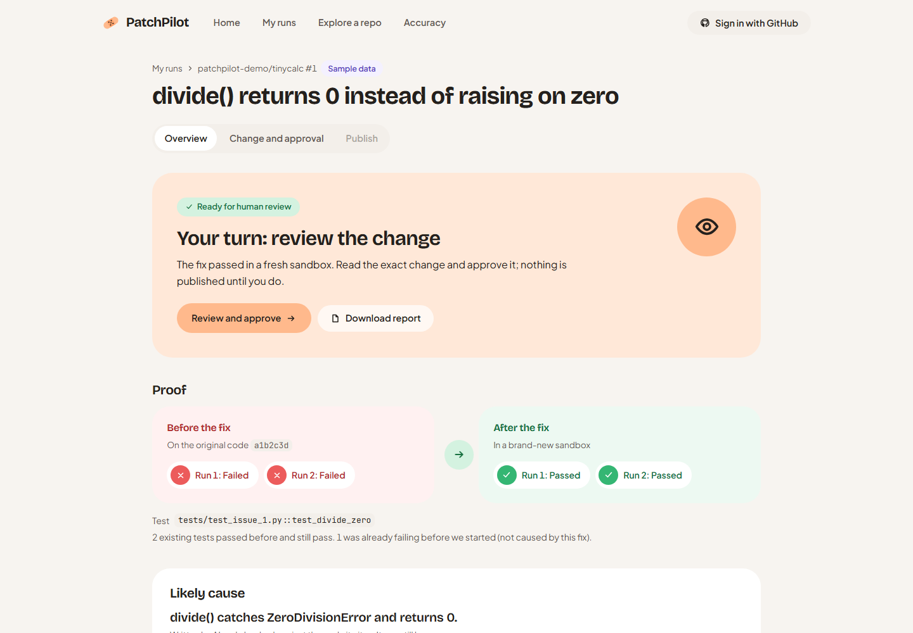
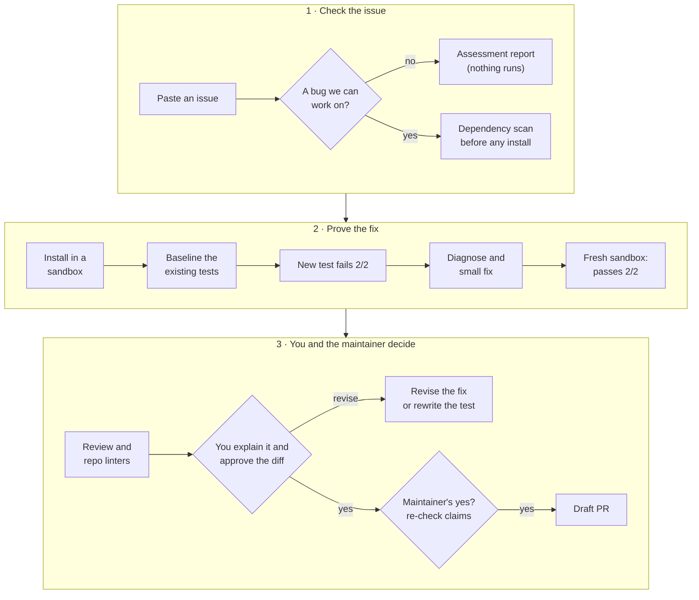
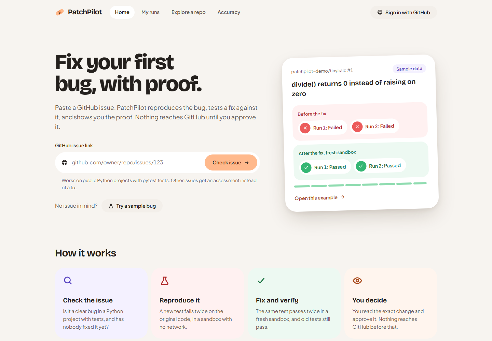
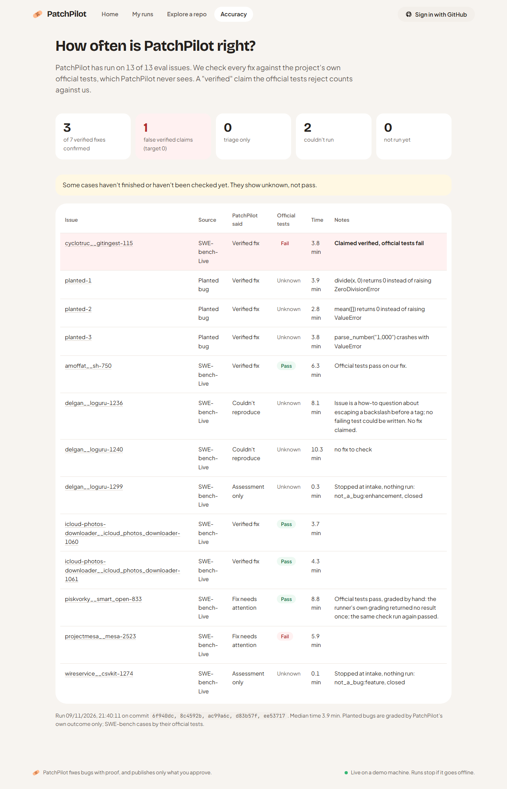
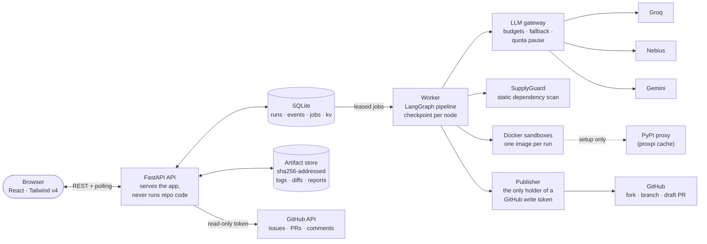
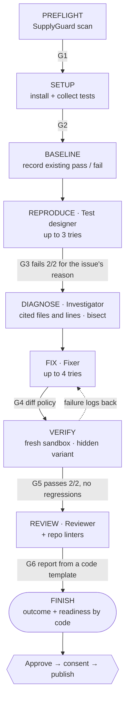
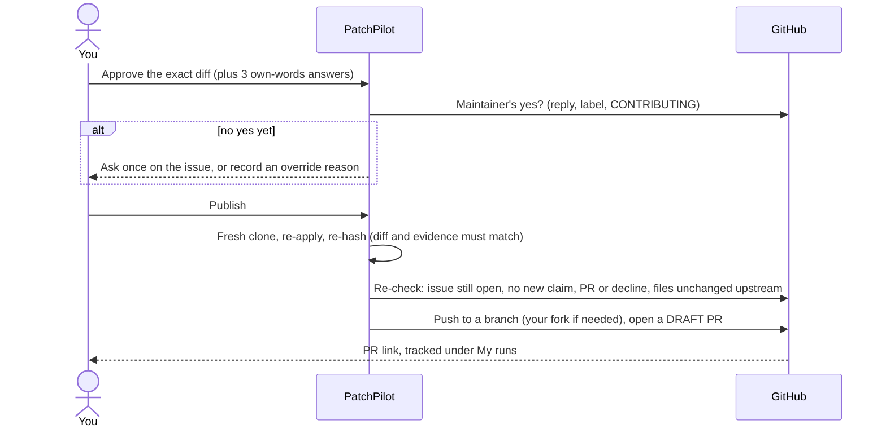

<div align="center">

# PatchPilot

### Turn a GitHub issue into a tested, human-owned fix that maintainers want to review.

Paste an issue from a public Python project. PatchPilot reproduces the bug in a locked-down sandbox and writes the
smallest fix it can. It then proves the fix: the new test **fails twice on the original code and passes twice in a
brand-new sandbox**. You explain the change in your own words, approve the exact diff, and open a draft PR only once a
maintainer has said yes.


**[Try the read-only showcase →](https://patchpilot-demo.vercel.app)** (real recorded runs, nothing to install)

[Proof](#proof-from-real-runs) · [How it works](#how-it-works) · [Architecture](#architecture) · [Agent orchestration](#agent-orchestration) · [Trust model](#trust-model) · [Accuracy](#accuracy) · [What's real](#whats-real-today) · [Known limits](#known-limits) · [Run it](#run-it-locally)

<sub>AgentX Hackathon 2026 · PS-05: bug-fix agent for code repositories</sub>

</div>

<p align="center">
  
  <br><sub>A finished run (sample data, labelled in the app). Red twice on the original code, green twice after the fix. Your turn to review.</sub>
</p>

---

## Proof from real runs

### A real open-source contribution: [wheelgap/wheelgap#133](https://github.com/wheelgap/wheelgap/pull/133)

The PR fixes [wheelgap#114](https://github.com/wheelgap/wheelgap/issues/114): `--online` sent private-index package
names to public PyPI. It's a project we don't control.

| Step | What happened |
|---|---|
| Intake | READY: a bug labelled "help wanted", nobody working on it, and a contributing guide that allows AI-assisted work |
| Reproduce → fix → verify | 3 new tests failed 2/2 on the original code and passed 2/2 in a fresh sandbox. All 529 existing tests still passed |
| Human ownership | The contributor answered the three ownership questions, approved the exact diff, and added the CHANGELOG line |
| Maintainer review | *"This looks good overall… the right shape, and the tests cover both lockfile formats."* |
| Follow-up | The maintainer raised three points. PatchPilot's Reviewer had already flagged two of them, but they weren't fixed before publishing. All three are addressed in one commit, which passes the repo's own CI checks (pytest, ruff check, ruff format, mypy) |
| Merge | The maintainer added two commits (kept the `requires-python` warning under `--online`, moved tests into existing files, tidied README and CHANGELOG) and **merged it on 2026-11-09** ([`0c269c3`](https://github.com/wheelgap/wheelgap/commit/0c269c3)): *"Keeping private-index packages on their locked files is exactly the fix #114 needed."* |

### Planted bugs on a demo repo

PatchPilot reproduced, fixed and verified each one end to end on
[`Niranjan-cyber/tinycalc`](https://github.com/Niranjan-cyber/tinycalc). A person approved each before it was opened:

| Issue | Draft PR |
|---|---|
| [#1](https://github.com/Niranjan-cyber/tinycalc/issues/1) `divide(x, 0)` returns 0 instead of raising | [#4](https://github.com/Niranjan-cyber/tinycalc/pull/4) |
| [#3](https://github.com/Niranjan-cyber/tinycalc/issues/3) `parse_number("1,000")` crashes | [#5](https://github.com/Niranjan-cyber/tinycalc/pull/5) |
| [#2](https://github.com/Niranjan-cyber/tinycalc/issues/2) `mean([])` returns 0 instead of raising | [#6](https://github.com/Niranjan-cyber/tinycalc/pull/6) |

## Why it's different

AI tools can already open PRs. Maintainers close them when they look unasked-for, unverified, or written by someone
who can't explain them. PatchPilot is built around the three things those PRs lack: proof, permission and ownership.

| Principle | What it means |
|---|---|
| **Proof, not promises** | "Verified" means a new test fails 2/2 on the original code and passes 2/2 in a fresh container, with every previously passing test still green. |
| **Honest when it can't** | If it can't verify a fix, you get a triage report (the reproduction, the likely cause, what was tried), never a fake "fixed". Unknown is shown as unknown, never as clean. |
| **Code decides, not the AI** | AI roles only *propose*. Every gate, outcome and readiness level is computed by code ([`docs/contracts.md`](docs/contracts.md)). |
| **You own the change** | Before approving, you answer in your own words what was broken, why the fix works and what the test proves. Approval is tied to the exact diff, and any change cancels it. |
| **Maintainers come first** | No PR without a maintainer's yes (a reply, a "help wanted" label, or an invitation in CONTRIBUTING), or a reason you type, which is labelled as an override. It asks at most once, respects a "no", and checks for other people's claims and PRs at the start and again just before publishing. |

## How it works



What you see at each step:

| Step | You see | Ends with |
|---|---|---|
| **Check** | Issue type, suitability by dimension (with whose words each piece of evidence is), existing claims and PRs | READY, or an assessment report with a reason |
| **Prove** | Live stage list, the failing test, the likely cause with cited files and lines, the fix, red-then-green proof | An outcome decided by code: Verified fix, Needs attention, Triage only, Can't reproduce, Env failed, Stopped |
| **Decide** | The exact diff, Reviewer findings by level, repo-check rows, the test-quality report, the three ownership questions | Approve, Revise the fix, Rewrite the test, or keep the report |
| **Publish** | Maintainer consent (found, asked, or overridden), a re-check of upstream, the PR text | A draft PR, published from your fork if you can't push to the repo |

<p align="center">
  
  
  <br><sub>Left: start from any issue link. Right: the Accuracy page grades every claim against the project's own tests.</sub>
</p>

## Architecture



| Layer | Built with | Why |
|---|---|---|
| UI | React, Vite, Tailwind v4, motion | One decision block per screen; status is always an icon plus a word |
| API | FastAPI | Owner-scoped (session hash or account), never executes repository code |
| Pipeline | LangGraph `StateGraph` + `SqliteSaver` | One checkpoint after every node, so a worker crash resumes at the same step |
| Jobs | SQLite queue with leases (60 s) and heartbeats (10 s) | Durable without extra infrastructure; 2 resumes per step, then an honest outcome |
| Sandboxes | Docker: non-root, all capabilities dropped, read-only root, CPU/memory/PID limits | Repository code runs only here, with **no network after setup** |
| Models | Nebius `DeepSeek-V4.1-Flash-1017` (paid, primary) → Groq `gpt-oss-120b` → Groq `qwen3.8-27b` → Gemini Flash; an optional local model handles short calls only | Free tiers first; a quota hit pauses the run rather than failing it |
| Evidence | Content-addressed artifacts (`sha256:<hex>`) | Every claim in a report cites an ID that exists |
| Publishing | GitHub OAuth (Fernet-encrypted token), fresh clone, diff re-hashed | Publishes only the exact approved bytes |

## Agent orchestration

Each AI role is a bounded shell agent: one bash command per step, inside its own network-less sandbox. Its output is
**always judged by a gate in code**. The graph never branches on a model's opinion.



| Role | Proposes | Checked by code |
|---|---|---|
| **Assessor** | Issue type, expected behaviour, acceptance conditions | A keyword and label cross-check. A non-bug is hard-blocked only when both agree, and a model outage is never READY |
| **Test designer** | A failing regression test, plus which expected behaviours it covers | **G3**: fails in both runs on an assertion or the issue's own error, never a syntax or import error it caused. Gaps it admits lower readiness |
| **Investigator** | Root cause, file and line locations, callers, regression risks | Every cited evidence ID and file line must exist in the pinned source; anything else is dropped |
| **Fixer** | The smallest source change | **G4**: source files only, at most 5 files and 200 lines, no test, dependency, CI or stray files. **G5**: fresh-container verification. An edit left at the step limit is still judged, but can never be Ready |
| **Reviewer** | Findings as BLOCKER, IMPORTANT, SUGGESTION or ACCEPTED_TRADEOFF, with file and line | Can only *lower* readiness. Code adds its own findings: new lint problems, silent `except`s, test-coverage gaps, a failed hidden variant |
| **Explainer** | Plain-language answers for first-time contributors | **G6**: the report is rendered from a code template; model text never changes a status |

Code-only helpers sit alongside the AI roles:
- **Hidden variant:** checks the fix against a test it never saw.
- **Commit bisection:** finds which commit introduced the bug.
- **Repo-native lint and type checks:** before and after the change.

**Budgets and failure handling:**
- **Per-run limits:** 600k tokens and 25 minutes of active time, plus a global daily cap.
- **Quota exhausted:** the run pauses for up to 2 hours, without guessing when it can resume.
- **Revise:** resumes at FIX, or at REPRODUCE with "Rewrite the test", and clears everything the old revision proved.

## Trust model

| Gate | Passes when | Otherwise |
|---|---|---|
| **G0 Eligibility** | Open, public, Python, tests found, a bug, nobody assigned or claiming it, no linked PR | Blocked (assessment only), or a warning the user must accept |
| **G1 Pre-flight** | No known-malicious or typosquatted dependency | Malicious: terminal, no override. Scanner unavailable: inconclusive, and publishing stays off |
| **G2 Setup** | Installs within 480 s and test collection finds at least one test | One AI-assisted retry of the install commands, then Env failed |
| **G3 Reproduction** | The new test fails 2/2 for the issue's reason | Up to 2 retries, then Can't reproduce |
| **G4 Diff policy** | Small, source-only, no test or dependency edits | Back to the Fixer with the reason |
| **G5 Verification** | Passes 2/2 in a fresh container, and the baseline still passes | Up to 3 Fixer retries, one re-diagnosis, then Triage only |
| **G6 Report integrity** | Every status equals the recorded one, and every claim cites existing evidence | Regenerated without AI narrative |

Readiness is capped at *Needs attention* in these cases:
- the dependency scan is inconclusive or the baseline is partial;
- the Reviewer lowers it;
- the issue never says what the right behaviour is;
- the fixer stopped without saying it was finished.

**Publishing** re-checks everything at the last moment:



## Accuracy

All 13 eval cases were run on 2026-11-09 ([Accuracy page screenshot](docs/evidence/eval-2026-11-09-full.png)). Each
real case is graded against **the project's own official tests, which PatchPilot never sees**.

| | Cases | Result |
|---|---|---|
| Planted bugs | 3 | **3/3 verified** |
| Real issues ([SWE-bench-Live](https://github.com/microsoft/SWE-bench-Live)) | 10 | **3 confirmed fixes** (sh, icloud ×2) · **1 false "verified"** (gitingest: an ambiguous issue; runs like it are now capped, #81) · **2 flagged Needs attention** (smart_open passes the official tests; mesa fails them) · **4 correct stops** (2 feature requests stopped at intake in under 20 s, a how-to question, a Cython-only bug) |
| Median time | | **3.9 min** per case |

The right decision was reached on 9 of 10 real issues. A correct stop counts as a success: PatchPilot's job is to avoid
unwanted PRs, not to maximise how many it opens.

## What's real today

| | Status |
|---|---|
| Intake, sandboxed install, baseline, reproduce, diagnose, fix, fresh-sandbox verify, review | **Real**, on any public Python repo with pytest tests |
| Draft PRs after approval | **Real**: [wheelgap#133](https://github.com/wheelgap/wheelgap/pull/133) (third-party, merged by its maintainer), [tinycalc #4](https://github.com/Niranjan-cyber/tinycalc/pull/4), [#5](https://github.com/Niranjan-cyber/tinycalc/pull/5), [#6](https://github.com/Niranjan-cyber/tinycalc/pull/6) |
| Suitability by dimension, existing-work checks at the start and at publish | **Real** |
| Maintainer consent, one "ask first" comment, override labelled as such | **Real**, enforced by the backend ([contracts §2.2](docs/contracts.md)) |
| Ownership answers, hash-bound approval, Revise the fix or the test | **Real** |
| Repo's own linters on the change (ruff, black, flake8, mypy, pyright) | **Real**, one row per tool: pass, fail, not run, unsupported or blocked |
| Test-quality report, Reviewer levels, Investigator's callers and risks | **Real**. Rows decided by code are labelled; the model's own claims are labelled as claims |
| Sample runs on the home page | **Sample data**, labelled in the app |
| [patchpilot-demo.vercel.app](https://patchpilot-demo.vercel.app) | **Recorded**: a real tinycalc run plus the sample runs, served as static files; nothing runs there |
| SupplyGuard dependency scan | Real, but it's the team's own scanner and isn't public yet. Without it the check reports **inconclusive** and publishing stays off. It never reports a false "clean" |
| gVisor sandbox runtime, hosted deployment | **Planned**: the deploy kit (`infra/vm-setup.sh`) is ready, and the prototype runs on a laptop |

## Known limits

- **"Correct" that the issue never states.** On gitingest our test followed the reporter's example, but the
  maintainers also wanted owner/repo lowercased. Such runs are now capped at *Needs attention*; PatchPilot can't know
  unstated preferences.
- **Environments the sandbox can't build:** Cython, Windows or macOS only, anything that needs the network, very large
  repos. These end as *Can't reproduce* or *Env failed*, never as a fake fix.
- **Hard fixes** can run out of steps or tokens. A half-finished edit is still checked, but it never reaches *Ready*.
- **Test coverage is self-reported.** Code can catch only the gaps the test designer admits; the Reviewer is the
  second net.
- **Repo CI beyond linters isn't run** (coverage gates, docs builds, Windows jobs), and fixes don't touch CHANGELOGs.
  On wheelgap#133, PatchPilot's own test file would have failed `ruff format`, which it had listed as *not run*.
- **Intake judgement:** it once said READY for an issue whose "help wanted" asked for user data, not code
  ([cgt-calc#1029](https://github.com/cgt-calc/capital-gains-calculator/issues/1029)).
- **Python only.** The prototype runs on a laptop with daily token budgets.

## Safety

- **Repository code runs only in sandboxes:** non-root, all capabilities dropped, read-only root filesystem, CPU,
  memory and process limits, and **no network after setup**. Setup can reach PyPI only, through the caching proxy.
- **Every run builds its own environment.** Nothing a repository builds is reused by another run.
- **Dependencies are scanned before anything is installed**, and `setup.py` is read with `ast`, never executed.
- **Credentials never reach the sandbox or the AI.** Only the publisher holds a GitHub write token, and only after you
  sign in and approve.
- **Nothing is published without a maintainer's yes** or your recorded override. The "ask first" comment is posted at
  most once per run.
- **Prototype limitation:** on Docker Desktop, sandboxes run without gVisor. Point it at repositories you'd be
  comfortable running tests from.

## Run it locally

You can explore the app with **sample runs and no keys at all**. To fix real issues you need one free AI key.

<details open>
<summary><b>1. Prerequisites</b></summary>

| Tool | Version | Why |
|---|---|---|
| [Docker](https://docs.docker.com/get-docker/) (Desktop on Windows/macOS) | running | every run happens in sandboxes |
| Python | 3.12+ | API and worker |
| [uv](https://docs.astral.sh/uv/) | recent | Python dependencies |
| Node.js | 20+ | builds the web app |

Tested on Windows 11 with Docker Desktop.
</details>

<details open>
<summary><b>2. Install</b></summary>

```bash
git clone https://github.com/Niranjan-cyber/patchpilot.git
cd patchpilot
cp .env.example .env
uv sync
cd web && npm ci && npm run build && cd ..
docker build -t pp-base:3.12 -f infra/Dockerfile.base infra
```
</details>

<details open>
<summary><b>3. Add keys to <code>.env</code> (for real runs)</b></summary>

| Variable | Needed for | Get it |
|---|---|---|
| `GROQ_API_KEY` | **real runs** (the AI roles) | free at [console.groq.com](https://console.groq.com/keys) |
| `GITHUB_READ_TOKEN` | strongly recommended: 5,000 GitHub API calls/h instead of 60 | [fine-grained token](https://github.com/settings/personal-access-tokens), public repos, **read-only** |
| `GEMINI_API_KEY`, `NEBIUS_API_KEY` | optional fallbacks when Groq is out of quota | [Google AI Studio](https://aistudio.google.com/apikey), Nebius |
| `SUPPLYGUARD_CMD` | the dependency scan (without it, G1 is inconclusive and publishing stays off) | the team's scanner |

Publishing a draft PR also needs a GitHub OAuth app (`GITHUB_OAUTH_CLIENT_ID/SECRET`), a `FERNET_KEY` and a public
`PUBLIC_URL` (see [Publishing](#publishing-optional)). Without them, runs still go all the way to a verified fix; only
the final "open a draft PR" step is off.
</details>

<details open>
<summary><b>4. Start it</b></summary>

```bash
uv run uvicorn backend.api.main:app --port 8000    # terminal 1: the app + API
uv run python -m backend.worker.main               # terminal 2: the worker that runs the sandboxes
```

Open **http://localhost:8000**. On Windows, `./scripts/deploy.ps1` does steps 2 and 4 in one go.
</details>

<details open>
<summary><b>5. Try it</b></summary>

- **No keys?** Scroll to *Sample runs* on the home page. Every way a run can end is there, labelled "Sample data".
- **With a key:** click **Try a sample bug** (tinycalc issue #1, about 2–7 minutes), or paste any issue from a public
  Python repo that has tests.

The first run pulls a small PyPI caching proxy (`epicwink/proxpi`) and fills its cache, so it's slower. Later runs reuse it.
</details>

<details>
<summary><b>Troubleshooting</b></summary>

| Symptom | Fix |
|---|---|
| Setup is slow or ends in `install_timeout` | Docker Desktop's network to PyPI can be flaky (VPNs make it worse). Re-run once: the proxy cache makes the second install fast. |
| "You've used today's runs" | Per-user daily limits live in `config/limits.toml`. Restart the API after editing it. |
| The page loads but shows no app | You skipped `npm run build`. The API serves `web/dist`. |
| A run says the AI is paused | The free AI quota is used up. Add a fallback key (`GEMINI_API_KEY`, `NEBIUS_API_KEY`), or continue the run later from its page. |
| Publishing says to sign in again | Your GitHub token expired or was revoked. Sign in with GitHub again; the new token replaces the old one. |
</details>

<details>
<summary><b>Publishing (optional)</b></summary>

1. Create a [GitHub OAuth app](https://github.com/settings/developers) with callback `PUBLIC_URL/auth/github/callback`.
2. Set `GITHUB_OAUTH_CLIENT_ID`, `GITHUB_OAUTH_CLIENT_SECRET` and `FERNET_KEY`. Generate the key with
   `uv run python -c "from cryptography.fernet import Fernet;print(Fernet.generate_key().decode())"`.
3. `PUBLIC_URL` must be reachable by GitHub. We use [Tailscale Funnel](https://tailscale.com/kb/1223/funnel) (`tailscale funnel --bg 8000`).
   Anyone with that URL can start runs while it's on, so turn it off when you're done.

PatchPilot publishes to the repo directly if you can push to it, and otherwise through your fork.
</details>

## Tests

```bash
uv run pytest                                                          # 611 unit + Docker integration tests
NODE_PATH=web/node_modules web/node_modules/.bin/playwright test       # browser checks (app running)
```

The seeded browser checks (`scripts/seed_*.py`) create fake runs **and queued jobs**, so they refuse to run without a
separate database. Run them against a second API with no worker:

```bash
PP_DB=data/e2e.db uv run uvicorn backend.api.main:app --port 8001     # test-only API, no worker
export PP_DB=data/e2e.db
set -- $(uv run python -m scripts.seed_review_run | tail -1)       # PP_TOKEN PP_RUN for the review page
PP_TOKEN=$1 PP_RUN=$2 PP_SEED="$(uv run python -m scripts.seed_diagnose_run | tail -1)" PP_SEED17="$(uv run python -m scripts.seed_variant_runs | tail -1)" PP_SEED16="$(uv run python -m scripts.seed_progress_runs | tail -1)" BASE_URL=http://localhost:8001 NODE_PATH=web/node_modules web/node_modules/.bin/playwright test
```

Last full run (2026-11-10): 611 backend tests pass; 27 browser checks pass, and 3 skip because they need a live run or
an exhausted rate limit. Two browser checks read live GitHub data and can be flaky.

## Repository map

| Path | What |
|---|---|
| `backend/contracts/` | Shared types, gates and outcome rules (source of truth: [`docs/contracts.md`](docs/contracts.md)) |
| `backend/api/` | FastAPI: the run API, approval, consent, auth; serves the app |
| `backend/worker/` | Durable job queue, the LangGraph pipeline, crash and resume, revisions |
| `backend/agents/` | AI roles (reproduce, diagnose, fix, review, explain) and code-only helpers (verify, hidden variant, bisect, lint, test quality) |
| `backend/gates/` | The code that judges them: G3 reproduction, G4 diff policy |
| `backend/github/` | Read-only GitHub access: intake assessment, suitability, consent, existing work, explore |
| `backend/sandbox/` | Docker sandboxes, setup, baseline, the dependency scan |
| `backend/publisher/` | The only writer to GitHub: fork, branch, draft PR, the ask comment |
| `web/` | React app |
| `eval/`, `scripts/eval*.py` | The 13-case fix eval and the 14-case intake eval |
| `docs/` | [contracts](docs/contracts.md), [architecture](docs/patchpilot-architecture.md), [feature scope](docs/patchpilot-feature-scope.md), [screen flows](docs/patchpilot-screen-flows.md), [design](docs/DESIGN.md), [build plan](docs/build-plan/BUILD-PLAN.md) |

## Team

Niranjan Iyer · Swarali Patil · Devansh Narlawar · Sarthak Viche. Each of us worked alongside a Claude Code session.
How we coordinated is in [`COORDINATION.md`](COORDINATION.md), the live channel in [`messages.md`](messages.md), and
every decision and lesson in [`LEARNING.md`](LEARNING.md).
