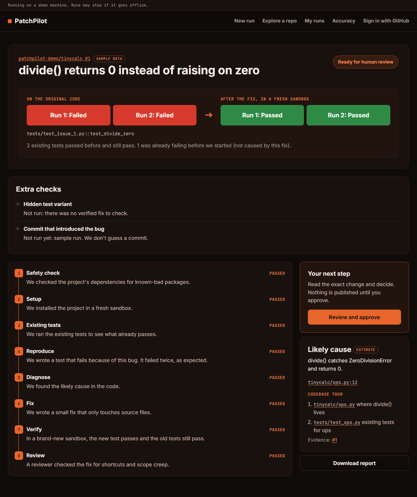
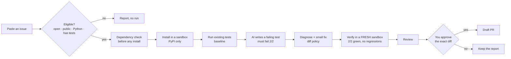

<div align="center">

# PatchPilot

**Turn a GitHub issue into a tested fix, with proof you can check.**

Paste an issue from a public Python project. PatchPilot reproduces the bug in a locked-down sandbox, writes a fix,
and shows you the same test **failing twice on the original code and passing twice after the fix**, in a brand-new sandbox.
Then *you* decide whether to open a draft pull request.

[Run it locally](#run-it-locally) · [How it works](#how-it-works) · [What's real](#whats-real-today) · [Safety](#safety)

<sub>AgentX Hackathon 2026 · PS-05: bug-fix agent for code repositories</sub>

</div>

<p align="center">
  
  <br><sub>A finished run (sample data, labelled as such in the app). Red twice on the original code, green twice after the fix.</sub>
</p>

---

## Proof from real runs

PatchPilot opened these draft pull requests on [`Niranjan-cyber/tinycalc`](https://github.com/Niranjan-cyber/tinycalc),
a small public demo repo with three planted bugs. Each one was reproduced, fixed and verified end to end, then approved by a person before it was opened:

| Issue | Draft PR opened by PatchPilot |
|---|---|
| [#1](https://github.com/Niranjan-cyber/tinycalc/issues/1) `divide(x, 0)` returns 0 instead of raising | [#4](https://github.com/Niranjan-cyber/tinycalc/pull/4) |
| [#3](https://github.com/Niranjan-cyber/tinycalc/issues/3) `parse_number("1,000")` crashes | [#5](https://github.com/Niranjan-cyber/tinycalc/pull/5) |
| [#2](https://github.com/Niranjan-cyber/tinycalc/issues/2) `mean([])` returns 0 instead of raising | [#6](https://github.com/Niranjan-cyber/tinycalc/pull/6) |

Each PR contains the new test and the fix. A person reviewed the exact diff before it was published, and nothing was merged automatically.

## Why it's different

| | |
|---|---|
| **Proof, not promises** | A fix counts as verified only when a new test fails 2/2 on the original code and passes 2/2 after the fix, in a fresh container, with every previously passing test still passing. |
| **Honest when it can't** | If it can't verify a fix, you get a triage report (the reproduction, the likely cause, what was tried), never a fake "fixed". |
| **Code decides, not the AI** | AI roles only *propose*. Every status, gate and outcome is computed by code ([`docs/contracts.md`](docs/contracts.md)). |
| **A human always decides** | Draft PRs only, after you approve the exact diff. If the diff changes, the approval is cancelled. |
| **Friendly to first-time contributors** | Plain-language steps, a short tour of the files that matter, and answers to "why does this test fail?" that cite their evidence. |

## How it works



Every arrow is a gate (G0–G6) evaluated by code. A step that can't finish stops the run with a reason. Failures are never shown as empty.

## Run it locally

You can explore the app with **sample runs and no keys at all**. To fix real issues you need one free AI key.

### 1. Prerequisites

| Tool | Version | Why |
|---|---|---|
| [Docker](https://docs.docker.com/get-docker/) (Desktop on Windows/macOS) | running | every run happens in sandboxes |
| Python | 3.12+ | API and worker |
| [uv](https://docs.astral.sh/uv/) | recent | Python dependencies |
| Node.js | 20+ | builds the web app |

Tested on Windows 11 with Docker Desktop.

### 2. Install

```bash
git clone https://github.com/Niranjan-cyber/patchpilot.git
cd patchpilot
cp .env.example .env
uv sync
cd web && npm ci && npm run build && cd ..
docker build -t pp-base:3.12 -f infra/Dockerfile.base infra
```

### 3. Add keys to `.env` (for real runs)

| Variable | Needed for | Get it |
|---|---|---|
| `GROQ_API_KEY` | **real runs** (the AI roles) | free at [console.groq.com](https://console.groq.com/keys) |
| `GITHUB_READ_TOKEN` | strongly recommended: 5,000 GitHub API calls/h instead of 60 | [fine-grained token](https://github.com/settings/personal-access-tokens), public repos, **read-only** |
| `GEMINI_API_KEY`, `NEBIUS_API_KEY` | optional fallbacks when Groq is out of quota | [Google AI Studio](https://aistudio.google.com/apikey), Nebius |

Publishing a draft PR also needs a GitHub OAuth app (`GITHUB_OAUTH_CLIENT_ID/SECRET`), a `FERNET_KEY` and a public `PUBLIC_URL` (see [Publishing](#publishing-optional)).
Without them, runs still go all the way to a verified fix; only the final "open a draft PR" step is off.

### 4. Start it

```bash
uv run uvicorn backend.api.main:app --port 8000    # terminal 1: the app + API
uv run python -m backend.worker.main               # terminal 2: the worker that runs the sandboxes
```

Open **http://localhost:8000**. On Windows, `./scripts/deploy.ps1` does steps 2 and 4 in one go.

### 5. Try it

- **No keys?** Scroll to *Sample runs* on the home page. Every way a run can end is there, labelled "Sample data".
- **With a key:** click **Try it on a real bug**. That opens tinycalc issue #1, a known bug, and a run takes about 2–7 minutes. Or paste any issue from a public Python repo that has tests.

The first run pulls a small PyPI caching proxy (`epicwink/proxpi`) and fills its cache, so it's slower. Later runs reuse it.

### Troubleshooting

| Symptom | Fix |
|---|---|
| Setup is slow or ends in `install_timeout` | Docker Desktop's network to PyPI can be flaky (VPNs make it worse). Re-run once: the proxy cache makes the second install fast. |
| "You've used today's runs" | Per-user daily limits live in `config/limits.toml`. Restart the API after editing it. |
| The page loads but shows no app | You skipped `npm run build`. The API serves `web/dist`. |
| A run says the AI is paused | The free AI quota is used up. Add a fallback key (`GEMINI_API_KEY`, `NEBIUS_API_KEY`), or continue the run later from its page. |

### Publishing (optional)

1. Create a [GitHub OAuth app](https://github.com/settings/developers) with callback `PUBLIC_URL/auth/github/callback`.
2. Set `GITHUB_OAUTH_CLIENT_ID`, `GITHUB_OAUTH_CLIENT_SECRET` and `FERNET_KEY`. Generate the key with
   `uv run python -c "from cryptography.fernet import Fernet;print(Fernet.generate_key().decode())"`.
3. `PUBLIC_URL` must be reachable by GitHub. We use [Tailscale Funnel](https://tailscale.com/kb/1223/funnel) (`tailscale funnel --bg 8000`).
   Anyone with that URL can start runs while it's on, so turn it off when you're done.

PatchPilot publishes to the repo directly if you can push to it, and otherwise through your fork.

## What's real today

| | Status |
|---|---|
| Issue check, sandboxed install, baseline, reproduce, diagnose, fix, fresh-sandbox verify, review | **Real**, on any public Python repo with pytest tests |
| Draft PRs after approval | **Real**: [tinycalc #4](https://github.com/Niranjan-cyber/tinycalc/pull/4), [#5](https://github.com/Niranjan-cyber/tinycalc/pull/5), [#6](https://github.com/Niranjan-cyber/tinycalc/pull/6) |
| Sample runs on the home page | **Sample data**, labelled in the app |
| SupplyGuard dependency check | Real, but it's the team's own scanner and isn't public yet. Without it the check reports **inconclusive** and publishing stays off. It never reports a false "clean". |
| Accuracy page (eval set) | The eval set exists (`eval/`); numbers aren't published yet |
| gVisor sandbox runtime, hosted deployment | **Planned**: the deploy kit (`infra/vm-setup.sh`) is ready, and the prototype runs on a laptop |

## Safety

- **Repository code runs only in sandboxes:** non-root, all capabilities dropped, read-only root filesystem, CPU, memory and process limits, and **no network after setup**. Setup can reach PyPI only, through the caching proxy.
- **Every run builds its own environment.** Nothing a repository builds is reused by another run.
- **Credentials never reach the sandbox or the AI.** Only the publisher holds a GitHub write token, and only after you sign in and approve.
- **Prototype limitation:** on Docker Desktop, sandboxes run without gVisor. Point it at repositories you'd be comfortable running tests from.

## Tests

```bash
uv run pytest                                                          # unit + Docker integration
NODE_PATH=web/node_modules web/node_modules/.bin/playwright test       # browser checks (app running)
```

## Repository map

| Path | What |
|---|---|
| `backend/contracts/` | shared types, gates, outcome rules (source of truth: [`docs/contracts.md`](docs/contracts.md)) |
| `backend/api/` | FastAPI: serves the app and the run API |
| `backend/worker/` | durable job queue, LangGraph pipeline, crash/resume |
| `backend/sandbox/` | Docker sandboxes, setup, baseline, dependency check |
| `backend/agents/`, `backend/gates/` | AI roles and the code that checks them |
| `web/` | React app |
| `docs/` | [architecture](docs/patchpilot-architecture.md), [feature scope](docs/patchpilot-feature-scope.md), [screen flows](docs/patchpilot-screen-flows.md), [build plan](docs/build-plan/BUILD-PLAN.md) |

## Team

Niranjan Iyer · Swarali Patil · Devansh Narlawar · Sarthak Viche. Each of us worked alongside a Claude Code session.
How we coordinated is in [`COORDINATION.md`](COORDINATION.md), the live channel in [`messages.md`](messages.md), and every decision and lesson in [`LEARNING.md`](LEARNING.md).
