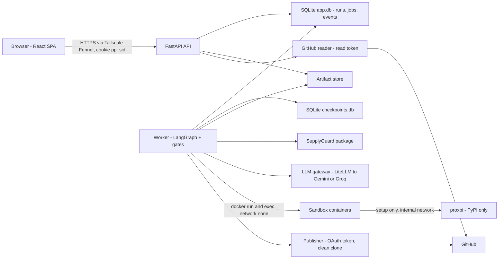
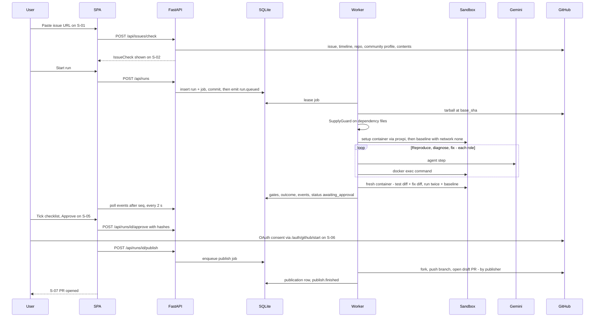

# PatchPilot: Architecture

## 1. Summary
PatchPilot takes a public GitHub issue URL for a Python repo. A trusted worker runs a LangGraph pipeline whose AI roles act only inside locked-down Docker containers: it reproduces the bug with a failing test, fixes it, and verifies the fix in a fresh container. After the user approves the exact diff, a separate publisher opens a draft PR. One UI serves first-time and experienced contributors (screen flows S-01…S-09). Shared types, events and the approval contract are in `docs/contracts.md`; this page says where each piece runs.
**Stack:** React + Vite (served by FastAPI, same origin) · FastAPI API · separate Python worker (LangGraph + mini-SWE-agent) · SQLite (WAL) + filesystem artifact store · Docker Desktop sandboxes · LiteLLM SDK → Gemini Flash (Groq for short calls) · SupplyGuard (our package) · GitHub REST + OAuth app · Tailscale Funnel → Windows laptop (prototype), Oracle Always Free Arm VM (MVP).

## 2. Stack
| Layer | Choice | Why (one line) | Limit that matters |
|---|---|---|---|
| Frontend | React + Vite SPA, built to `web/dist`, **served by FastAPI** | same origin keeps the `pp_sid` cookie first-party; no CORS | — |
| Live updates | **Polling** `GET /api/runs/{id}/events?after=<seq>` every 2 s (SSE optional later) | works through any tunnel; same event envelope as `contracts.md` §3 | Cloudflare Quick Tunnels don't support SSE |
| API | FastAPI + Uvicorn, 1 process | team's Python stack; never runs repo code | — |
| Worker | separate Python process: job loop + LangGraph graph, `langgraph-checkpoint-sqlite` | durable runs, resume after a crash (screen flows §1.2) | one host; 1 concurrent run on the laptop |
| AI roles | mini-SWE-agent `DefaultAgent` + `DockerEnvironment` (commands via `docker exec`) | shell-only agent; we check diffs, not instructions | step limit per role (15–20); output must be Pydantic JSON |
| LLM gateway | LiteLLM **SDK** inside the worker, wrapped by `llm_gateway.py` (token accounting, budgets, redaction, logging) | provider swap = config; no extra proxy service | Gemini free: per-*project* quotas, daily reset at midnight Pacific; Groq: 8K tokens/min |
| DB | SQLite, WAL mode, `data/app.db` + `data/checkpoints.db` | zero ops; API + worker on one host | single writer; keep transactions short |
| Artifacts | `data/artifacts/sha256/<ab>/<hash>` files | content-addressed = evidence IDs | prune by run age (§7) |
| Sandbox | Docker Desktop (WSL2 backend) on Windows | team host | **no gVisor** on Docker Desktop; workspaces in Docker volumes, not `C:\` bind mounts (slow) |
| Package proxy | `proxpi` (PyPI caching proxy) container on an `--internal` network | the only host setup containers can reach (PyPI only) | first install of a repo is slow; later ones are cached |
| Dependency check | SupplyGuard Python package, imported by the worker | our own tool; runs before any install | unsupported formats → `inconclusive` |
| GitHub read | REST with a server **read-only token** (fine-grained, public repos, no write) + ETag caching | 60 req/h unauthenticated vs 5,000/h with a token | one issue check ≈ 6 calls |
| GitHub write | OAuth app, scope `public_repo`, used **only** by the publisher module | fine-grained tokens can't open PRs on repos you're not a member of | redirect URL host must match the registered callback, so the hostname must be stable |
| Public URL | **Tailscale Funnel** (`<host>.<tailnet>.ts.net`, port 443) | free and a stable hostname (needed for OAuth) | beta; undocumented bandwidth caps |

## 3. Components

Trust zones (brief §6): sandbox = untrusted (no credentials; no network after setup) · LLM gateway = semi-trusted (sees code and issue text; never tokens) · API, worker, publisher, DB = trusted. **Only `PUB` can decrypt a user's OAuth token.** The API process never executes repo code.

## 4. Golden path (demo: verified fix → fork PR)

**Where it can fail:**
- Bad, private or non-Python issue → `IssueCheck` error code → S-01/S-02 Failed or Unsupported.
- GitHub 403/429 → `GITHUB_UNAVAILABLE` with `retry_after` → S-02 Failed.
- Malicious package → BLOCKED → S-04 Blocked.
- SupplyGuard error → `supplyguard.status=inconclusive` + `DEPS_INCONCLUSIVE` blocker → S-04 Dependency check inconclusive.
- proxpi/PyPI down, or install over 8 min → ENV_FAILED → S-04 Setup failed.
- LLM 429 → `run.paused` (`resume_at` from `retry-after` or the Gemini midnight-PT reset, else null) → S-03 Paused.
- Worker dies → lease expires → `run.interrupted` → `run.resumed` → S-03 Interrupted.
- Hash or issue changed → `HASH_MISMATCH` / `APPROVAL_STALE` → S-05 Failed / Stale. Files in our diff changed upstream (compare API) → `UPSTREAM_CHANGED` → S-05 Stale with Re-run on latest code. SupplyGuard re-checked after approval → approval voided, `DEPS_REPORT_CHANGED` → S-05 approve again.
- Fork PR refused → `branch_only` + `compare_url` → S-07 Partial.

## 5. Data model (SQLite `app.db`)
| Table | Key columns | Notes |
|---|---|---|
| sessions | id_hash PK (sha256 of `pp_sid`), ip_hash, created_at, last_seen_at, revoked_at NULL | token never stored raw |
| accounts | id PK, github_id UNIQUE, login, token_enc (Fernet), scopes, created_at | `token_enc` decrypted only in `publisher/` |
| runs | run_id PK, owner_session_hash NULL, owner_account_id NULL, issue_url, repo, issue_number, base_sha, status, outcome NULL, end_reason NULL, readiness NULL, revision, publish_blockers JSON, state_json, created_at, updated_at | **every query filters by owner** (session hash or account); NULL outcome = not finished, never a default |
| jobs | id PK, run_id FK, kind enum(analyze, publish, recheck_deps), state enum(queued, running, paused, succeeded, failed), lease_owner, lease_expires_at, heartbeat_at, available_at, attempt, error_category NULL | commit the run row first, then insert the job in the same transaction |
| events | (run_id, seq) PK, ts, type, step NULL, revision, payload JSON | append-only; the polling endpoint reads `seq > after` |
| artifacts | id PK (`sha256:…`), run_id FK, kind (log, diff, test_output, report, sg_report), size, path, created_at | evidence IDs |
| approvals | run_id + revision PK, diff_hash, evidence_hash, approved_by, approved_at, checklist JSON, explanation NULL, pr_title, pr_summary, voided_at NULL | at most one non-voided row per run |
| publications | run_id PK, head_branch, fork_owner NULL, pr_number NULL, pr_url NULL, compare_url NULL, status enum(created, updated, branch_only, failed), gh_state NULL (open/merged/closed), gh_checked_at NULL | gh_state NULL = unknown → "Status unavailable" |
| issue_cache | url PK, etag, payload JSON, fetched_at, status enum(ok, failed), error_code NULL | failures stored as failures, never as empty |
| env_recipes | (repo, base_sha) PK, python_version, base_image_digest, install_cmds JSON, succeeded_at, source_run_id | **data only**, never an image: replayed as commands in a fresh container. This is the agent's "memory" (contracts §7) |
| llm_calls | id, run_id, role, provider, model, prompt_tokens, completion_tokens, latency_ms, status (ok, rate_limited, error, fallback), ts | budget accounting + the eval slide |
| usage_counters | (scope enum(session, account, global), key, day) PK, runs, llm_tokens | enforced in API (`POST /api/runs`) and gateway |
| fp_reports | id, run_id, package, note, created_at, status enum(open, confirmed, rejected) | reviewed with an admin CLI; never unblocks the run |

Provenance labels shown in the UI come from the contracts' models: issue summary and AI-policy reading = *estimate* (with source file IDs); test results, SupplyGuard and GitHub status = *observed*.

## 6. API endpoints
All are in `contracts.md` §4, plus one change: **events are polled**: `GET /api/runs/{id}/events?after=<seq>&wait=0` returns `{events: [...], next_after}` (SSE at the same path with `Accept: text/event-stream` is optional). Screen usage:

| Endpoint | Used by |
|---|---|
| POST `/api/issues/check` | S-01 → S-02 |
| POST `/api/runs`, GET `/api/runs/{id}`, GET `…/events` | S-02 → S-03, S-03/S-04 refresh |
| POST `…/stop` | S-03 |
| POST `…/revise`, `…/approve` | S-05 |
| POST `…/publish` | S-06 → S-07 |
| POST `…/recheck-deps`, `…/false-positive` | S-04 |
| DELETE `…/access`, GET `/api/me/runs` | S-08 |
| GET `/api/artifacts/{id}`, `…/report.md`, `…/diff.patch` | S-03 details, S-04 downloads |
| GET `/auth/github/start`, `/auth/github/callback`, POST `/auth/logout` | S-06 |
| GET `/api/runs/{id}/pr-status` (refreshes gh_state if older than 10 min) | S-07, S-08 |
| GET `/healthz` (DB writable, worker heartbeat < 30 s, Docker reachable, **global LLM budget set**) | demo-day check, S-01 Demo server banner |
| POST `…/keep-report`, `…/rerun` | S-04, S-05 (Stale / upstream changed) |

Errors return `{code, message, retry_after}` with a real status code (contracts §4). The SPA maps codes to the Failed / Setup-needed states, never to empty lists. "Not found" and "not yours" are both 404.

## 7. Background jobs (worker process)
| Job | Trigger | States | Retries / timeout | Notes |
|---|---|---|---|---|
| analyze | `POST /api/runs`, `…/revise`, `…/rerun` | job: queued → running ⇄ paused → succeeded (an outcome is always set, per contracts §1.2, including `STOPPED`) / failed (infra only; the run still gets an outcome) | lease 60 s, heartbeat 10 s; 2 resumes per step; 25 min active, 2 h max pause | gates exactly as contracts §1.1; run status per §1.3; checkpoint after every node; **per-run setup image**, a fresh container + fresh workspace volume per step |
| publish | `POST …/publish` | queued → running → succeeded / failed | idempotent: look up the existing branch/PR first; 3 retries with backoff on 5xx/secondary limits | runs in `publisher/` with the decrypted token in memory only |
| recheck_deps | `POST …/recheck-deps` | queued → running → succeeded / failed | 1 retry | a changed result voids the approval |
| reaper | worker loop: leases every 60 s, retention daily | — | — | expired leases → `run.interrupted`; removes containers/volumes when a run leaves RUNNING; deletes per-run images after 48 h; applies the retention table in contracts §9 (logs 14 d; report, diff, summary 30 d; then a tombstone) |
| PR status | on read of `/pr-status` | — | cached 10 min | no cron; failures leave gh_state as-is plus `gh_checked_at` |

**No cross-run environment reuse:** each run builds `pp-run-<run_id>` from a pinned base image digest by replaying the saved recipe (if any) or detecting one. Setup runs repository code, so its output is trusted only inside that run. Shared state is limited to the read-only base images and `proxpi` (PyPI-only upstream, no uploads).

**Sandbox recipe** (every container): `--user 1000:1000 --cap-drop ALL --security-opt no-new-privileges --pids-limit 512 --memory 2g --cpus 2 --read-only` (+ tmpfs `/tmp`, workspace volume rw), no Docker socket, no env secrets, a per-command timeout. Setup: network `pp_setup` (`--internal`, proxpi only), `UV_INDEX_URL=http://proxpi:5000/index/`. Every later step: `--network none`. The repo arrives as a GitHub **tarball at base_sha**, extracted by the worker (no `git clone`, so no hooks or submodules), then `git init` + baseline commit inside the volume so diffs are exact.

## 8. External services and data sources
| Service / source | Used for | Limit | When it fails or blocks | Fallback | May claim |
|---|---|---|---|---|---|
| GitHub REST (read) | issue, comments, timeline (cross-referenced PRs), repo, `community/profile` (CONTRIBUTING, PR template), contents, tarball | 5,000/h with the read token; ETag 304s reduce use | 403/429 → `GITHUB_UNAVAILABLE` + `retry_after` → S-02 Failed; partial lookups → S-02 Partial ("Couldn't check") | cached `issue_cache` if < 10 min old, labelled with fetch time | Observed |
| GitHub OAuth + REST (write) | fork, push (git over HTTPS with the token), draft PR | 80 content requests/min, 500/h | secondary limit → retry after `retry-after`; PR refused → `branch_only` + compare link → S-07 Partial | download diff + report | Observed (PR URL/state from GitHub) |
| Gemini API (free, Flash) | all agent roles | per-project RPM/TPM/RPD (check AI Studio); RPD resets midnight PT | 429 → gateway pauses the run with `resume_at` = retry-after or next midnight PT → S-03 Paused | Groq for Explainer/Reviewer only (small prompts) | — |
| Groq (free) | Explainer, Reviewer, issue summary | ~8K TPM, 1K RPD on gpt-oss-120b | 429 with `retry-after` → wait or use Gemini | Gemini | — |
| PyPI via proxpi | dependency install | upstream availability | install error → one AI-assisted retry (commands only) → ENV_FAILED → S-04 | cached wheels from earlier runs | Observed (install log) |
| SupplyGuard | pre-flight + re-check | supported formats only | exception/unsupported → `inconclusive` → publishing off (D10) | none; never "clean" | Observed findings; "not a proof of security" |

Fixtures: `fixtures/github/` has a real issue (`pallets/click` #3888), its timeline, the repo record, root contents and community profile. Note from the samples: unauthenticated requests are limited to 60/h by IP; the timeline only contained `commented/mentioned/subscribed` (linked PRs appear as `cross-referenced` with `source.issue.pull_request`); `community/profile.files` reports `contributing` and `pull_request_template`. An AI policy can also live in README/docs, so the reader also scans those files. Add `fixtures/runs/*` (contracts §8) before UI work starts.

## 9. Build rules
- **AI proposes, code decides:** gate statuses, outcome and readiness come from runner exit codes and `contracts.md` rules; LLMs only write tests/fixes/explanations.
- **Validate every role output** with Pydantic; invalid JSON = a failed attempt. Every fallback (Groq instead of Gemini, retry) is written to `llm_calls` and visible in Show details.
- **Commit before you enqueue:** insert `runs` + `jobs` in one transaction; emit `run.queued` only after the commit.
- **Explicit job states** with `error_category` (repo, provider_quota, infra, policy); never infer status from missing rows.
- **Unknown is NULL:** `outcome`, `gh_state`, `resume_at`, SupplyGuard status are NULL/`inconclusive` until observed; the UI never shows 0 or "clean" for unknown.
- **Don't cache failures as empty:** `issue_cache.status=failed` is a distinct row; partial eligibility checks show "Couldn't check".
- **Scope every query to the owner** (`owner_session_hash` / `owner_account_id`) in one repository helper; test that another session gets 404.
- **Secrets stay in the trusted zone:** logging middleware strips Cookie/Authorization/Set-Cookie/OAuth params; the LLM gateway redacts token-like strings; containers get no env secrets; only `publisher/` imports the Fernet key.
- **Bounded external calls:** GitHub timeouts 10 s, 2 retries; tarball size cap (e.g. 200 MB); only `github.com`/`api.github.com` URLs accepted on intake (no SSRF).
- **Stale responses never overwrite edits:** the SPA keys polling by `seq` and ignores older responses; S-05 checklist and PR title/summary edits live in local state until submitted.
- **Distinct page states** exactly as in the screen-flow state tables; every API error code has a mapped state.
- **Health + demo ops:** `/healthz` checked before demos; disable laptop sleep; `.env` edited one variable at a time; a seed script that creates demo runs through the same API.

## 10. Prototype vs MVP
| Area | Prototype (demo week, 11–14 Nov) | MVP (real users) |
|---|---|---|
| Host | Windows laptop, Docker Desktop, Tailscale Funnel | Oracle Always Free Arm VM (Ubuntu), Docker Engine + **gVisor `runsc`**, Funnel or a named tunnel |
| Sandbox hardening | everything in §7 except gVisor (documented in README + S-01 banner) | + gVisor, + host firewall egress rules |
| Concurrency | 1 run at a time | 2 runs; same SQLite design |
| LLM | Gemini free + Groq for short calls | same; per-account caps tuned from `llm_calls` |
| Demo repos | team-owned upstream repo with planted bugs + 2–3 hand-picked repos; `proxpi` pre-warmed by a rehearsal run, so installs are quick (no reused images) | any public Python repo (honest ENV_FAILED when setup fails) |
| False positives | `fp_reports` row + admin CLI | same, plus an email to the team |
| Should features (S1–S6) | after the demo path runs twice end to end | as built |
| Nothing faked on the core path | real GitHub, real sandbox, real LLM; pre-recorded backup run for the video | — |

## 11. Risks and open questions
| Risk / question | Mitigation or who decides |
|---|---|
| Free Gemini quota can't sustain 2–5 runs/user/day | M3 feasibility test measures tokens per run → set `global_llm_tokens_per_day`; using several free projects to multiply quota may break Google's terms, so check before doing it |
| Docker Desktop without gVisor is a weaker sandbox | no network after setup, no secrets, cap-drop, read-only root. **The laptop prototype is a demo, not a hardened public service:** only controlled demo repos (team-owned + hand-picked); Docker Desktop's "expose daemon on tcp without TLS" stays off; no host folders are mounted into containers; the host's `.env` (OAuth secret, Fernet key, read token) is readable only by the API/worker user; the UI banner and README say so. gVisor comes with the MVP VM |
| Setup can tamper with test tooling inside its own run (e.g. a patched pytest) | per-run images (no cross-run poisoning); demo on controlled repos; SupplyGuard pre-flight; the report states that verification trusts the run's own environment |
| Tailscale Funnel on Windows (beta) is untested by us | 1-hour test: Funnel + OAuth callback + 2 s polling from a phone on mobile data; backup: Cloudflare named tunnel if someone buys a domain |
| SQLite lock contention between API and worker | WAL, short transactions, checkpoints in a separate DB file, busy_timeout 5 s |
| Arm VM (MVP): some wheels missing for aarch64 | ENV_FAILED is honest; note "Arm host" in the report |
| SupplyGuard's supported formats/API are unknown to this doc | SupplyGuard's owner adds a `scan(paths) -> SGReport` adapter matching contracts §2 |

## 12. Sources
- [Cloudflare Quick Tunnels](https://developers.cloudflare.com/cloudflare-one/connections/connect-networks/do-more-with-tunnels/trycloudflare/): no SSE, 200 in-flight requests, random URL → polling + Funnel
- [Tailscale Funnel](https://tailscale.com/kb/1223/funnel): all plans, ts.net URL, ports 443/8443/10000, beta
- [GitHub REST rate limits](https://docs.github.com/en/rest/using-the-rest-api/rate-limits-for-the-rest-api): 60/h unauthenticated, 5,000/h tokens, 80/min and 500/h content creation
- [Gemini rate limits](https://ai.google.dev/gemini-api/docs/rate-limits): per project, RPD reset at midnight PT, exact numbers in AI Studio
- [Groq rate limits](https://console.groq.com/docs/rate-limits): 8K TPM / 1K RPD on gpt-oss-120b; `retry-after`, `x-ratelimit-reset-*` headers
- [gVisor install](https://gvisor.dev/docs/user_guide/install/): Linux 5.6+, x86_64/arm64; Docker Desktop not covered
- [mini-SWE-agent](https://mini-swe-agent.com/latest/): DockerEnvironment, LiteLLM models, Python API
- `fixtures/github/*` (fetched 30 Oct 2026 from api.github.com): issue/timeline/repo/community-profile shapes
