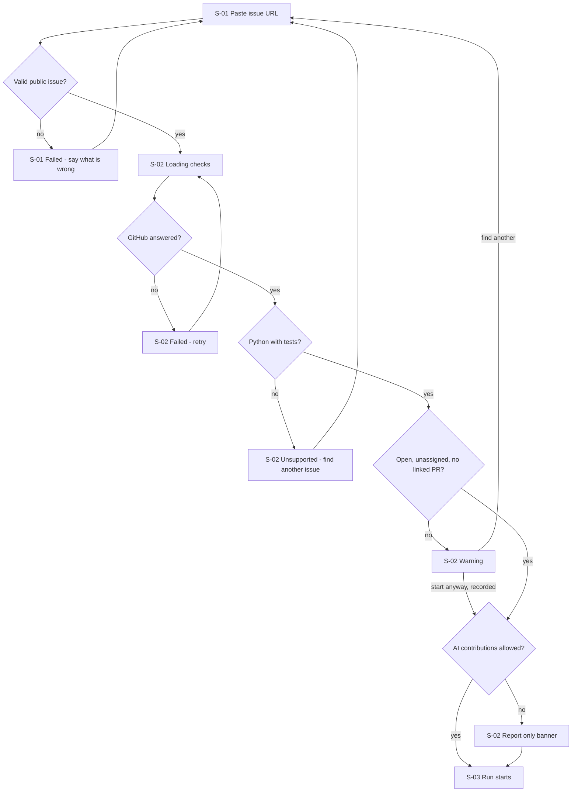
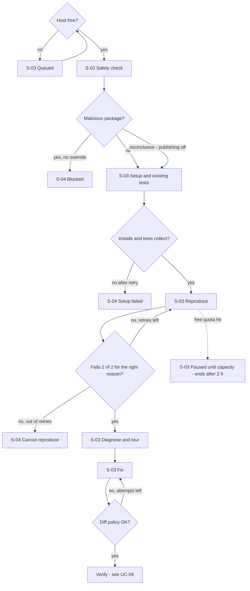
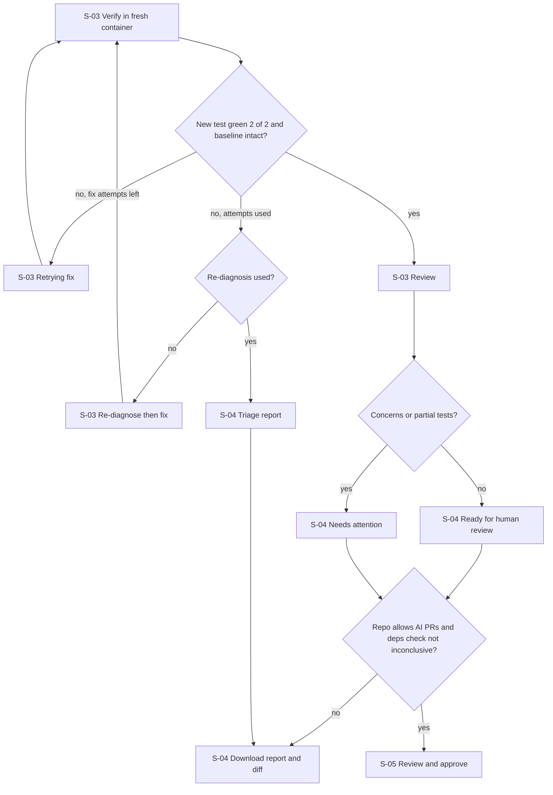
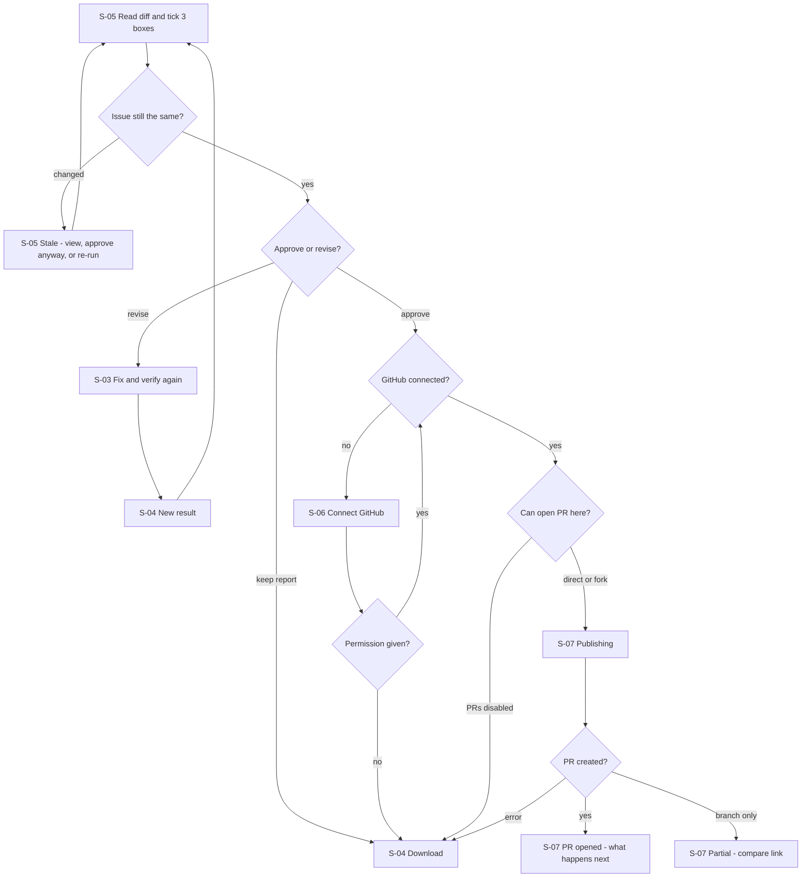
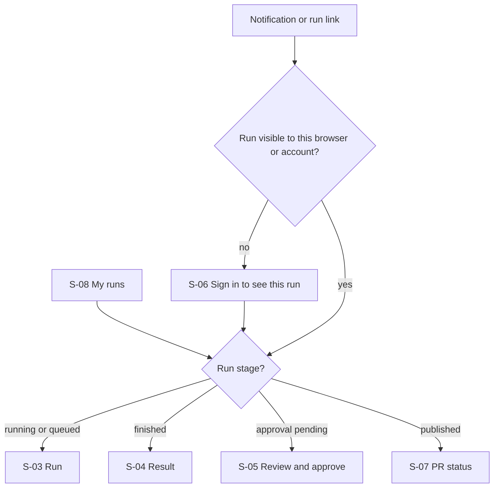
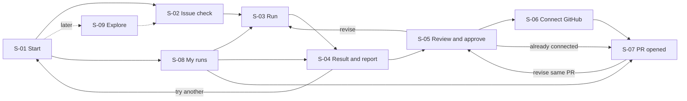

# PatchPilot: Screen Flows

## 1. Summary
- **Target users:** first-time contributors, including people who have never opened a pull request, and regular or intermediate contributors and maintainers, working on public Python repos they may not own (feature scope §1).
- **Job:** turn one GitHub issue into evidence (a reproduction, a diagnosis, and a fix proven by a test that fails before it and passes after), then open a draft PR only after approval.
- **Core loop:** 1. Paste issue URL → 2. Sandbox setup + baseline → 3. Reproduce → diagnose → fix → 4. ⭐ Fresh-container verification + honest report → 5. Approve exact diff → draft PR (or keep the report).
- **Platform:** responsive web, desktop first · **Login:** none to start a run; GitHub sign-in only to publish or save history.

**One UI for everyone: how it serves both levels**
- Every step has a **one-line plain-language headline** that's always visible ("We're installing the project so we can run its tests").
- Technical depth (logs, raw test output, full diff, evidence IDs) sits one click away under **Show details**, in the same place on every screen. Beginners can ignore it; experienced users open it.
- Every technical term (pull request, fork, branch, draft, diff, regression test, baseline, flaky, sandbox) is underlined and opens a **"What's this?"** popover with two sentences and no jargon. This is one shared glossary component, not a screen.
- Nothing in the UI assumes the user knows git. The user never types a git command.

**Decisions and assumptions**
| # | Question | Answer | Source |
|---|---|---|---|
| D1 | Adapt to experience level? | One view for all; explainers on demand (headline + Show details + glossary) | user |
| D2 | User leaves mid-run (runs take ~4–15 min, ≤ 25 min) | Run continues in a separate worker (see §1.2); each run has its own URL; runs without sign-in open only in the browser that started them and move to the account on sign-in; optional browser notification when finished or approval needed | user |
| D3 | Help after the PR | "PR opened: what happens next" screen + PR status tracked in My runs | user |
| D4 | Pre-publish step | Light checklist for everyone (3 boxes + optional "explain in your own words") | user |
| D5 | Run screen layout | One live Run page with a stepper, not a screen per agent step | assumed |
| D6 | Sign-in timing | Asked only at publish or "save my runs"; never before the first result | scope M5, brief 12.4 |
| D7 | Q&A panel and guided pauses (S2) | A side panel on S-03/S-04; pauses are off by default and toggled from the Run page | scope S2, assumed placement |
| D8 | Who can open a run | Anonymous run: only the originating browser (HttpOnly cookie token). Other browser: sign in with GitHub, which claims the run. No resume links, no public reports | user |
| D9 | Override a BLOCKED (malicious / typosquat) result | **Not possible in the MVP.** "Report a false positive" goes to a team review queue; the run stays blocked | user |
| D10 | SupplyGuard inconclusive | Analysis continues in the sandbox; readiness capped at Needs attention; **publishing disabled** until a later check is clean; report and diff downloadable | user |
| D11 | Abuse limits | Server-enforced, configurable; defaults in §1.3 | user |
| D12 | Resume time when paused for quota | Shown only when the provider returns one (Retry-After header or documented reset); otherwise "paused until capacity is available"; a run paused > 2 h ends with the report so far | user |

### 1.1 Run access (D8)
- The run URL holds only a **non-secret run ID** (`/runs/<id>`). Access is granted by an unguessable, revocable **browser session token** (256-bit random, stored server-side only as a hash) in an `HttpOnly; Secure; SameSite=Lax` cookie. Runs started in that browser are owned by the session, and "Forget this run" removes one run from it (details in `docs/contracts.md` §6). The token never appears in URLs, page HTML, application logs, error reports or analytics events.
- Signing in **claims** the run: it's attached to the account and the browser token is revoked. From then on it opens on any device where that account is signed in.
- Another browser without the cookie or sign-in sees S-06 in the state "Sign in to see this run". It never sees run content, and the page doesn't say whether the run exists.
- "Forget this run" on S-04/S-08 revokes the token. All run, report and PR-status pages send `noindex`, aren't linked publicly, and aren't in any sitemap.

### 1.2 Background execution guarantee (D2)
- The browser only watches. A run is a **job in a durable queue** (a SQLite table with leases and heartbeats), executed by a **separate worker process**. LangGraph checkpoints are written to SQLite after every node.
- **Worker crash or restart:** the job's lease expires, and the worker resumes from the last completed node. The interrupted step re-runs in a new container; this doesn't count as an agent attempt. Publishing is idempotent (it checks for the existing branch and PR before creating them), so a crash mid-publish can't open a second PR.
- **Disconnect:** the UI keeps polling `events?after=<last seq>` and receives every event it missed from the event log.
- **Demo-week caveat, stated in the UI and README:** while the host is a laptop, **runs stop if the laptop sleeps, shuts down or loses power**. The tunnel (Tailscale Funnel) only exposes the laptop; it's not always-on compute. After the laptop comes back, the worker resumes queued and interrupted runs from their checkpoints. S-01 shows a "Demo server" banner while hosted on a laptop.

### 1.3 Limits (D11), all enforced on the server
| Scope | Default | What the user sees when hit |
|---|---|---|
| Anonymous browser session (+ hashed IP as a backstop) | 2 runs/day, 1 at a time | S-01 "You've used today's 2 free runs. Sign in with GitHub for more, or come back tomorrow." |
| GitHub account | 5 runs/day, 1 at a time | S-01 "You've used today's 5 runs. Resets at 00:00 UTC." |
| Global sandbox concurrency | 1 run at a time on the laptop, 2 on a VM | S-03 Queued "You're 2nd in line" |
| Global daily LLM token budget | set from the M3 feasibility test | S-01 "Free capacity is used up for today" · running runs → S-03 Paused |
| Per run | ~300k LLM tokens · gate retry limits (repro 2, fix 3, re-diagnose 1) · 25 min active runtime · 8 min setup · 2 h max pause | the run ends with the best honest outcome so far (S-04), and the report says which limit was hit |

## 2. Use cases
| ID | Feature | Goal | Trigger | Priority |
|---|---|---|---|---|
| UC-01 | M1 | Check whether an issue is a good candidate | Pastes an issue URL | Must |
| UC-02 | M2 | Get the project running in a sandbox and record the baseline | Clicks Start run | Must |
| UC-03 | M3 | Reproduce, diagnose and fix the bug | Setup passes | Must |
| UC-04 | M4 | See a verified result or an honest triage report | Fix attempt finishes, or a run ends early | Must |
| UC-05 | M5 | Approve the exact diff and open a draft PR | Clicks Review and approve | Must |
| UC-06 | M5 | Ask for a revision | Clicks Revise on S-05 | Must |
| UC-07 | M5 | Come back to a run, see past runs | Returns via run URL, notification or My runs | Must |
| UC-08 | S2 | Ask "Why this file?" and pause at chosen steps | Opens Ask panel / toggles pauses | later |
| UC-09 | S3 | See contribution progress over time | Opens My progress | later |
| UC-10 | S5 | Find an issue PatchPilot can run in one repo | Pastes a repo URL on S-01 | later |
| — | S4 / S6 | Hidden-variant result and bisect commit shown as extra rows on S-04 | Run completes | later |

### UC-01: Check whether an issue is a good candidate
- **Main steps:** 1. Paste the issue URL on S-01. 2. S-02 shows the plain summary (expected vs. actual) and the checklist. 3. All green → **Start run**.
- **Failure paths:** bad or private URL, non-Python repo → S-01 Failed with the reason · closed, assigned or linked open PR → S-02 Warning, with "Start anyway" (recorded) or "Find another issue" · AI policy forbids → S-02 runs in report-only mode (publish disabled, reason shown) · GitHub rate limit → S-02 Failed with retry time.
- **Outcome:** the run is created with a pinned commit → S-03.

### UC-02: Sandbox setup + baseline
- **Main steps:** 1. SupplyGuard checks dependency files. 2. Install. 3. Collect tests. 4. Baseline: pass / fail / flaky.
- **Failure paths:** confirmed malicious or typosquatted package → `BLOCKED` (S-04; **no override**; "Report a false positive") · install fails after one retry → `ENV_FAILED` (S-04, install log) · SupplyGuard down, lookup failed or format unsupported → "Dependency check inconclusive"; analysis continues, publishing disabled (D10) · host busy → S-03 Queued · daily limit reached → S-01 limit message (§1.3).
- **Outcome:** the environment is ready; baseline sets are shown.

### UC-03: Reproduce → diagnose → fix
- **Main steps:** 1. Reproduction test written; fails 2/2 for the right reason. 2. Diagnosis with file:line and a short codebase tour. 3. Fix diff passes the diff policy.
- **Failure paths:** can't reproduce after 2 retries → `CANNOT_REPRODUCE` (S-04 triage report) · diff policy violation → shown in the step's history, Fixer retries (counts as an attempt) · LLM quota exhausted → S-03 Paused (a time only if the provider gives one, D12; ends after 2 h) · per-run token or runtime cap hit → best honest outcome (S-04), limit named · worker crash → resumes from the last checkpoint (§1.2).
- **Outcome:** a candidate fix goes to verification.

### UC-04: Verified result or honest triage report
- **Main steps:** 1. Fresh container: new test 2/2 green, baseline still green. 2. Reviewer may lower the rating. 3. S-04 shows the readiness badge, red → green, explanation, limitations, download.
- **Failure paths:** verification fails → back to the Fixer (≤ 3), one re-diagnosis, then `TRIAGE_ONLY` · report integrity mismatch → regenerated automatically (the user never sees the mismatched version).
- **Outcome:** Ready for human review / Needs attention → S-05 · Unable to verify → triage report download, "Try another issue".

### UC-05: Approve + publish draft PR
- **Main steps:** 1. S-05: read the exact diff, tick the 3 boxes, Approve. 2. Not signed in → S-06 Connect GitHub (permissions in plain words). 3. Access check: direct branch or fork, explained. 4. Publish → S-07.
- **Failure paths:** issue changed since the run (closed, new linked PR) → S-05 Stale, re-check · OAuth cancelled → S-06 Setup needed; diff and report download still offered · fork PR rejected (PRs restricted) → S-07 Partial with a pre-filled compare link · diff hash mismatch → publish refused, "re-approve".
- **Outcome:** a draft PR URL, with "what happens next".

### UC-06: Revise
- **Main steps:** 1. On S-05 type feedback ("don't change the public function name"). 2. Approval is voided; S-03 restarts at Fix → Verify. 3. Back to S-04 with the new diff.
- **Failure paths:** revision can't be verified → S-04 shows the new outcome; the earlier verified diff stays available as "Previous version".
- **Outcome:** a new diff ready for approval.

### UC-07: Come back
- **Main steps:** 1. Notification, saved run link, or S-08 My runs. 2. Opens the run on its current screen (S-03 if running, S-04/S-05 if finished, S-07 if published).
- **Failure paths:** run link opened in another browser → S-06 "Sign in to see this run". It never shows content or says whether the run exists; sign-in shows it only if this account started or claimed it · run expired (workspace cleaned) → report and logs still viewable; "Re-run" offered · laptop host was off → the run shows "Interrupted, resuming" once the worker is back (§1.2).

## 3. Screen inventory

### S-01: Start
- **Purpose:** paste an issue URL. · **Loop step:** 1 · **Serves:** UC-01, UC-07, later UC-10
- **Entry points:** home, header logo, "Try another issue" from any screen
- **What's on it:**
  | Element | Data shown | Source | Label |
  |---|---|---|---|
  | URL box | "Paste a GitHub issue link, e.g. github.com/owner/repo/issues/123" | — | — |
  | "New to this?" strip | 3 steps in plain words: we reproduce the bug → we test a fix → you decide whether to open a PR | static | — |
  | What works today | "Public Python repos with tests. Other projects get a report, not a fix." | static | — |
  | Recent runs | last 5 runs in this browser or account, with outcome badge | local storage / account | Observed |
  | Free capacity | "Runs left today: 2 of 2" (per session or account, §1.3); when the global budget is used up: "Free capacity is used up for today" | server limits | Observed |
  | Demo server banner | "Running on a demo machine: runs may stop if it goes offline" (only while laptop-hosted) | config | — |
  | Explore tab (later) | "Have a repo but no issue? Find one" | — | — |
- **Primary action:** Check issue → S-02 · **Secondary:** open a recent run, Explore (later)
- **States:**
  | State | When | User sees | Next action |
  |---|---|---|---|
  | Empty | first visit, no runs | URL box + "New to this?" strip; no Recent runs block | paste URL |
  | Success | has past runs | Recent runs list | open a run |
  | Failed (input) | not a GitHub issue URL, PR URL, private repo | "That's a pull request link. Paste the issue it fixes." / "This repo is private; we only read public repos." | fix the URL |
  | Setup needed (limit) | session or account daily limit hit, or a run is already active | "You've used today's 2 free runs. Sign in for more." / "You already have a run going." | sign in / open the active run |
  | Setup needed (capacity) | global LLM budget used up | "Free capacity is used up for today. You can still read your past reports." (a reset time only if known) | open past runs |

### S-02: Issue check
- **Purpose:** decide whether this issue is worth a run. · **Loop step:** 1 · **Serves:** UC-01
- **Entry points:** S-01 Check issue
- **What's on it:**
  | Element | Data shown | Source | Label |
  |---|---|---|---|
  | Issue summary | title; "Expected:" and "What happens instead:" in plain words; missing-info flags ("no steps to reproduce given") | issue + comments, LLM summary | Estimate (AI summary), link to the original |
  | Repo card | owner/repo, language, last commit date, pinned commit SHA | GitHub API | Observed |
  | Eligibility checklist | open · unassigned · no linked open PR · Python detected · tests found | GitHub REST/GraphQL, repo files | Observed |
  | Contribution rules | CONTRIBUTING found? AI policy: allowed / forbidden / not stated; PRs limited to collaborators? | repo files, LLM reading | Estimate (AI reading of the docs), link to the file |
  | Publishing preview | "If a fix is verified you can open a draft PR from your fork" or "Report only: this repo doesn't accept AI-assisted PRs" | derived | — |
- **Primary action:** Start run → S-03 · **Secondary:** Start anyway (when warned, recorded), Find another issue → S-01
- **States:**
  | State | When | User sees | Next action |
  |---|---|---|---|
  | Loading | fetching issue and repo | "Reading the issue and checking the repo…" with a checklist ticking as items arrive | — |
  | Success | all checks pass | green checklist, summary, Start run | Start run |
  | Partial | some checks couldn't run (e.g. linked-PR lookup failed) | the checks that ran; failed ones as "Couldn't check" (never ✓) | Retry checks / Start anyway |
  | Warning | closed, assigned, linked open PR | which check failed, why it matters ("someone may already be working on this"), skipped by default | Find another issue / Start anyway |
  | Report only | AI policy forbids or PRs disabled | yellow banner with a link to the rule; run allowed, publish will be disabled | Start run (report only) |
  | Unsupported | not Python, no tests found | "PatchPilot can only run Python projects with tests today." | Find another issue |
  | Failed | GitHub API down or rate-limited | "GitHub didn't answer. Try again in N min." Summary kept if loaded | Retry |

### S-03: Run (live)
- **Purpose:** watch the run, or leave and come back. · **Loop steps:** 2–3 (and 4 while verifying) · **Serves:** UC-02, UC-03, UC-06, UC-07, later UC-08
- **Entry points:** S-02 Start run, S-05 Revise, run URL, notification, S-08
- **What's on it:**
  | Element | Data shown | Source | Label |
  |---|---|---|---|
  | Stepper | Safety check → Setup → Existing tests → Reproduce → Diagnose → Fix → Verify → Review, each with a status (passed / failed / inconclusive / not run / blocked) | run state via event polling | Observed |
  | Step headline | one plain line per step, e.g. Reproduce: "We wrote a test that should fail because of this bug. It failed twice, as expected." | Explainer + recorded result | Observed status, AI wording |
  | Show details | commands, exit codes, test output, test diff, fix diff, attempt history (with diff-policy rejections) | artifact store | Observed |
  | Diagnosis card | likely cause, file:line links, evidence; **codebase tour**: 3–5 relevant files, one line each on why it matters | Investigator | Estimate (labelled "hypothesis") |
  | Run header | elapsed time, "usually 4–15 min", attempt counters, run link with Copy, "Notify me when done" | run state | Observed |
  | Ask panel (later, S2) | "Why this file?", "What does this test prove?" | Explainer over evidence | AI answer citing evidence |
  | Pause toggles (later, S2) | pause after issue summary / repro / diagnosis / diff | user setting | — |
- **Primary action:** none needed (it runs by itself) → S-04 when finished · **Secondary:** Copy link, Notify me, Stop run (keeps the report so far)
- **States:**
  | State | When | User sees | Next action |
  |---|---|---|---|
  | Queued | host busy | "You're 2nd in line. Your run will start automatically." | leave and come back / Notify me |
  | Running | step in progress | the active step pulses; headline says what it's doing now; finished steps show results | Show details / Copy link / leave |
  | Running (setup, long) | install > 2 min | "Installing dependencies can take up to 8 minutes the first time. Later runs reuse downloaded packages and the install steps that worked, but every run installs into a fresh, clean sandbox." | leave and come back |
  | Retrying | G3/G4/G5 failed, attempt n of max | "The first fix didn't pass the tests. Trying again (2 of 3) with what we learned." Earlier attempt kept in details | — |
  | Paused (quota) | provider rate or daily limit hit | Reset known: "Paused: free AI capacity resumes around hh:mm." Unknown: "Paused until free AI capacity is available. We'll stop and keep your report if that takes over 2 hours." | leave / Stop and keep report |
  | Interrupted | worker restarted or host was offline | "The run was interrupted and is resuming from the last finished step." | — |
  | Paused (guided, later) | user-chosen pause point | the item to review + Continue / Stop | Continue |
  | Blocked | SupplyGuard malicious/typosquat | → S-04 with BLOCKED | — |
  | Failed (system) | the same step fails to resume after 2 attempts | "Something broke on our side, not in the repo. Here's the report so far." | Download report / Report problem |
  | Disconnected | live connection lost | "Reconnecting… The run continues on our server." | — |

### S-04: Result and report
- **Purpose:** show what was proven, honestly. · **Loop step:** 4 · **Serves:** UC-04, UC-06, later S4/S6 rows
- **Entry points:** S-03 when finished, run URL, S-08
- **What's on it:**
  | Element | Data shown | Source | Label |
  |---|---|---|---|
  | Readiness badge | Ready for human review / Needs attention / Unable to verify a fix / Unable to verify, plus one sentence why | gate results | Observed |
  | ⭐ Proof panel | the new test: **red on original (2/2) → green after fix (2/2), in a fresh container**; baseline: "41 of 41 tests that passed before still pass; 2 were already failing (not caused by this fix)" | verifier records | Observed |
  | What changed | plain explanation: what the bug was, what the fix does, why it should help | Explainer citing evidence IDs | AI explanation, citations clickable |
  | Diff summary | files changed, +/− lines; full diff in Show details | fix diff | Observed |
  | Reviewer notes | concerns with severity, or "No concerns raised" | Reviewer | AI review |
  | Dependency check | SupplyGuard findings, files checked, unsupported or failed lookups | SupplyGuard | Observed; "inconclusive" when lookups failed |
  | Limitations | what wasn't checked, what remains uncertain; "Passing tests don't prove the code is bug-free" | report | — |
  | Download | report (Markdown) + diff | artifact store | — |
- **Primary action:** Review and approve → S-05 (only for Ready / Needs attention, not report-only, and only with a non-inconclusive dependency check) · **Secondary:** Download report, Try another issue, Re-run
- **States:**
  | State | When | User sees | Next action |
  |---|---|---|---|
  | Success: Ready | VERIFIED_FIX | green badge + proof panel | Review and approve |
  | Success: Needs attention | verified, Reviewer concerns or only part of the existing tests could run | amber badge; concerns listed first | Review and approve / Revise |
  | Triage report | TRIAGE_ONLY | "We reproduced the bug and found the likely cause, but couldn't verify a fix." Repro test, diagnosis, attempted approaches | Download report / copy repro test to post on the issue / Try another issue |
  | Can't reproduce | CANNOT_REPRODUCE | "We couldn't make the bug happen in a test." What was tried, what info is missing from the issue | Download / Try another issue |
  | Setup failed | ENV_FAILED | "We couldn't install this project." Last 50 lines of the install log in plain words + full log | Download log / Try another issue |
  | Blocked | BLOCKED (confirmed malicious / typosquat) | the risky package, why it was flagged, "nothing from this repo was installed or run" — **no override** | Try another issue / Report a false positive (team review; the run stays blocked) |
  | Dependency check inconclusive | SupplyGuard down, lookup failed or format unsupported | result shown; badge capped at Needs attention; "We couldn't fully check this project's dependencies, so publishing is turned off." | Download report and diff / Re-check dependencies (enables publishing if clean) |
  | Report only | verified but repo forbids AI PRs | result shown; publish disabled with the rule linked | Download report and diff |
  | Partial | some baseline tests couldn't run | the missing parts named; badge capped at Needs attention | continue |
  | Logs expired | 14–30 days after the run | report, diff and summary still viewable; Show details says "Logs expired after 14 days" | Download report / Re-run |
  | Details expired | > 30 days | "This run's details have expired." The outcome and PR link are kept (tombstone) | Re-run / Open PR on GitHub |
  | Stopped | user stopped or a limit was hit before an outcome could be decided (`STOPPED`), or after it (best honest outcome + "Stopped" note) | where it stopped and everything recorded so far; **never publishable** | Download report / Re-run |

### S-05: Review and approve
- **Purpose:** the human gate, on the exact diff. · **Loop step:** 5 · **Serves:** UC-05, UC-06
- **Entry points:** S-04 Review and approve
- **What's on it:**
  | Element | Data shown | Source | Label |
  |---|---|---|---|
  | Exact diff | side-by-side or unified diff of source + test files; each hunk has "Explain this change" | approved candidate | Observed |
  | PR preview | title, body (issue link, summary, test evidence, dependency summary, limitations, AI-assistance note) | generated | AI draft, editable title/summary |
  | Checklist | ☐ I read the changes ☐ I understand what they change ☐ The AI-assistance note can be included. Optional: "Explain the change in your own words" | user | Your data |
  | Revise box | "What should change?" | user | Your data |
- **Primary action:** Approve and continue → S-06 (or straight to publish if already connected) · **Secondary:** Revise → S-03 (Fix step), Keep report only → S-04 download, Cancel
- **States:**
  | State | When | User sees | Next action |
  |---|---|---|---|
  | Success | diff loaded | diff + checklist; Approve disabled until 3 boxes ticked | tick, Approve |
  | Stale (issue) | issue closed or a new linked PR (`ISSUE_CHANGED`) | "Since your run started, someone linked a PR to this issue." Approve blocked by default | View the other PR / Approve anyway (recorded) / Keep report only |
  | Stale (upstream) | a file in our diff changed on the default branch since the pinned commit (`UPSTREAM_CHANGED`) | "`src/app/parse.py` changed upstream after we tested. Publishing is blocked so we don't open a PR that was never tested against that code." No approve-anyway | Re-run on latest code (new run, full re-verification) / Download report |
  | Re-approve needed | dependencies were re-checked after approval (`DEPS_REPORT_CHANGED`) | "The dependency check changed, so your earlier approval no longer counts. Please review the current evidence." Checklist cleared | review, tick, Approve |
  | Revision running | Revise submitted | "Previous approval no longer counts. Re-running the fix and verification." | → S-03 |
  | Failed | diff hash mismatch | "The diff changed after you approved it, so we stopped. Please review it again." | review again |
- **Edits:** the checklist, PR title/summary edits and revise text are kept locally while a background re-check finishes; a re-check result never clears them. Editing the PR title/summary doesn't void approval (it's not part of the diff); any change to the diff does, and S-05 says so before you submit Revise.

### S-06: Connect GitHub
- **Purpose:** get only the permission needed to publish, in plain words. · **Loop step:** 5 · **Serves:** UC-05, UC-07 (save runs)
- **Entry points:** S-05 Approve (not signed in), header "Sign in to save your runs"
- **What's on it:**
  | Element | Data shown | Source | Label |
  |---|---|---|---|
  | Permission explainer | "We'll ask GitHub for permission to: create a copy of the repo under your account (a fork), push one branch, and open one draft pull request. We can't merge anything, and the AI never sees this permission." | static | — |
  | Access result | after sign-in: "You can push to this repo directly" / "We'll use your fork: username/repo" / "This repo doesn't accept PRs from outside collaborators" | GitHub API | Observed |
  | Fork explainer | glossary popover: what a fork is, that it's free and stays under your account | static | — |
- **Primary action:** Connect with GitHub (OAuth) → access check → Publish draft PR → S-07 · **Secondary:** Not now: download diff + report
- **States:**
  | State | When | User sees | Next action |
  |---|---|---|---|
  | Setup needed | not connected | permission explainer + Connect | Connect |
  | Sign in to see this run | run URL opened without this browser's cookie | "Sign in with the GitHub account that owns this run." No run details, and no hint whether the run exists | Connect / → S-01 |
  | Not your run | signed in, but the run belongs to another account or another browser | "This run isn't available to this account." (same wording whether or not it exists) | → S-01 |
  | Loading | OAuth return, checking access | "Checking what you can do on owner/repo…" | — |
  | Success (direct) | has write access | "We'll open a draft PR on a new branch in owner/repo." | Publish |
  | Success (fork) | no write access | "We'll fork to your account and open a draft PR from there." | Publish |
  | Blocked | PRs disabled or collaborators only | "This repo only accepts PRs from collaborators." | Download diff + report / copy the repro test to the issue |
  | Failed | OAuth cancelled or denied | "No permission was given, so nothing was published." | Try again / Download diff + report |

### S-07: PR opened: what happens next
- **Purpose:** close the loop and coach the next step. · **Loop step:** 5 (outcome) · **Serves:** UC-05, UC-07
- **Entry points:** S-06 Publish, S-08
- **What's on it:**
  | Element | Data shown | Source | Label |
  |---|---|---|---|
  | PR card | PR link, draft status, branch/fork, created time | GitHub API | Observed |
  | What happens next | 4 short steps: 1. Look at your draft PR on GitHub. 2. When you're happy, click "Ready for review". 3. A maintainer may ask for changes; that's normal. 4. If they do, come back and use Revise to update the same PR | static | — |
  | What not to expect | "Maintainers decide whether to merge. A closed PR isn't automatically a failure." | static | — |
  | Live status | open / merged / closed, checks status, comment count | GitHub API | Observed (from GitHub) |
- **Primary action:** Open on GitHub · **Secondary:** Revise (updates the same PR via S-05 → S-03), My runs, Try another issue
- **States:**
  | State | When | User sees | Next action |
  |---|---|---|---|
  | Loading | publishing | "Applying the approved diff on a clean copy… Pushing branch… Opening draft PR…" | — |
  | Success | PR created | PR card + next steps | Open on GitHub |
  | Partial | branch pushed, PR creation refused | "Your branch is on your fork. Click below to open the PR yourself." Pre-filled compare link | Open compare link |
  | Already exists | re-publish on the same run | "Updated your existing draft PR #45." | Open on GitHub |
  | Failed | push/API error | "Nothing was published." Error in plain words | Retry / Download diff |
  | Status unavailable | GitHub status fetch fails later | "Couldn't fetch the latest status from GitHub" (never shows "closed" or "open" as a guess) | Retry |

### S-08: My runs (→ My progress, later)
- **Purpose:** find past runs and PRs. · **Loop step:** return · **Serves:** UC-07, later UC-09
- **Entry points:** header, S-01 Recent runs, S-07
- **What's on it:**
  | Element | Data shown | Source | Label |
  |---|---|---|---|
  | Runs list | issue title, repo, date, outcome badge, run status (running / needs approval / finished) | PatchPilot store | Observed (PatchPilot) |
  | PR column | PR link + GitHub status | GitHub API | Observed (GitHub), shown separately |
  | Later (S3) | issues explored, outcomes, repos, languages, skills over time; never a score, streak or rank | PatchPilot store + GitHub | Observed, with source per column |
- **Primary action:** open a run → S-03/S-04/S-05/S-07, depending on its stage · **Secondary:** Sign in to keep runs across devices
- **States:**
  | State | When | User sees | Next action |
  |---|---|---|---|
  | Empty | no runs | "No runs yet. Paste an issue to start." | → S-01 |
  | Success | runs exist | list, newest first; "needs your approval" runs pinned on top | open run |
  | Browser-only | not signed in | "These runs open only in this browser. Sign in to see them on other devices." Each run has a "Forget this run" action (revokes its token) | Sign in to keep them |
  | Partial | GitHub status fetch failed | PR column shows "Status unavailable", never blank or "closed" | Retry |

### S-09: Explore (later, S5)
- **Purpose:** find an issue PatchPilot can actually run, for one repo. · **Serves:** UC-10
- **Entry points:** S-01 Explore tab
- **What's on it:** paste a repo URL → a shortlist of 3–5 issues, each with: why it may fit, effort S/M/L *(Estimate, reasons shown)*, readiness signals (clear expected behavior, tests exist, setup cached, open, unassigned, no linked PR) *(Observed where from the API)*, what you may learn. Action: Check this issue → S-02.
- **States:** Loading "Scanning open issues…" · Success · Empty "No open issues look runnable here. Labels like good-first-issue don't guarantee an easy issue." → try another repo · Partial (some issues couldn't be checked) · Failed (GitHub error) → Retry · Unsupported (not Python).

## 4. Flows

### Flow UC-01: Check an issue

### Flow UC-02 and UC-03: Setup, reproduce, diagnose, fix

### Flow UC-04: Verify and report

### Flow UC-05 and UC-06: Approve, publish, revise

### Flow UC-07: Come back

## 5. Navigation map

Header on every screen: logo (→ S-01) · My runs (→ S-08) · Sign in / avatar (→ S-06). The Ask panel (later) opens from S-03, S-04 and S-05.

## 6. Coverage
| Feature | Acceptance criterion | Use case | Screen | State |
|---|---|---|---|---|
| M1 | Card within 5 s with pinned SHA | UC-01 | S-02 | Loading → Success |
| M1 | Closed / assigned / linked PR → warn, skip by default, override recorded | UC-01 | S-02 | Warning |
| M1 | AI policy forbids → report only, publish disabled with reason | UC-01, UC-04 | S-02, S-04 | Report only |
| M1 | Bad URL / private / non-Python / rate limit → specific message | UC-01 | S-01, S-02 | Failed, Unsupported |
| M2 | SupplyGuard before install; malicious → BLOCKED; outage → inconclusive | UC-02 | S-03, S-04 | Running, Blocked, Partial |
| M2 | Install fails after retry → ENV_FAILED with log | UC-02 | S-04 | Setup failed |
| M2 | Baseline pass/fail/flaky shown; fresh per-run environment, quicker on repeat via recipe + package cache | UC-02 | S-03, S-04 | Running (setup), Success proof panel |
| M3 | Repro fails 2/2 for the right reason; else CANNOT_REPRODUCE | UC-03 | S-03, S-04 | Running, Retrying, Can't reproduce |
| M3 | Diagnosis cites existing evidence | UC-03 | S-03 | Diagnosis card |
| M3 | Diff-policy violations returned to the Fixer | UC-03 | S-03 | Retrying (attempt history in details) |
| M3 | Free quota exhaustion handled | UC-03 | S-03, S-01 | Paused (quota), Setup needed (capacity) |
| M4 | Fresh container, new test 2/2, baseline intact; else retries → TRIAGE_ONLY | UC-04 | S-03, S-04 | Retrying, Success, Triage report |
| M4 | Reviewer can only lower the rating | UC-04 | S-04 | Needs attention |
| M4 | Statuses match records; claims cite evidence | UC-04 | S-04 | all (citations clickable) |
| M4 | Every path ends in a downloadable report | UC-04 | S-04 | every terminal state has Download |
| M5 | Approval tied to diff hash; revision voids it; mismatch refused | UC-05, UC-06 | S-05 | Revision running, Failed |
| M5 | Direct / fork / compare link / download fallbacks | UC-05 | S-06, S-07 | Success (direct/fork), Blocked, Partial |
| M5 | One PR per run; re-publish updates it | UC-05 | S-07 | Already exists |
| M5 | Token only in publisher; permissions explained | UC-05 | S-06 | Setup needed |
| M5 | Per-session, per-account and global limits; per-run caps (§1.3) | UC-02, UC-03, UC-07 | S-01, S-03, S-04 | Setup needed (limit / capacity), Queued, Paused (quota), terminal state naming the limit |
| M5 | Simple run list | UC-07 | S-08 | Success, Browser-only |
| M2 | BLOCKED can't be overridden; false-positive report goes to team review | UC-02 | S-04 | Blocked |
| M2 | Inconclusive dependency check → analysis continues, publishing disabled | UC-02, UC-04 | S-04 | Dependency check inconclusive |
| — | Run access: originating browser or signed-in owner only; token never in URL or logs | UC-07 | S-06, S-08 | Sign in to see this run, Not your run, Browser-only |
| — | Runs survive disconnect and worker restart (§1.2) | UC-07 | S-03 | Disconnected, Interrupted |

## 7. Demo path (≤ 3 min video)
| Step | Screen | What to show |
|---|---|---|
| 1 | S-01 → S-02 | Paste an issue from the team's upstream repo (owned by a second account); checklist ticks green; "AI contributions: allowed"; open one "What's this?" popover to show the beginner help |
| 2 | S-03 | Stepper: safety check clean → quick setup (warm package cache) → existing tests (one already-failing test shown honestly) → reproduction test **fails 2/2** → diagnosis + codebase tour (speed up the recording; say "usually 4–15 min") |
| 3 | S-04 | ⭐ Proof panel: **red → green in a fresh container**, baseline intact, "Ready for human review", plain-language explanation and limitations |
| 4 | S-05 | Exact diff, tick 3 boxes, Approve |
| 5 | S-06 → S-07 | Connect GitHub (permission screen in plain words) → "We'll use your fork" → draft PR opened → what happens next; cut to the maintainer account seeing the PR with branch protection |
| 6 | S-04 (second run) | 15 s: a different issue ending in an honest **triage report** with Download |

## 8. Open questions and assumptions
- **Assumed:** one Run page with a stepper (D5); the Ask panel and pauses as a side panel (D7); retention follows contracts §9: logs 14 days; report, diff and summary 30 days; then a tombstone (outcome + PR link).
- **Decided:** run access, no BLOCKED override, the inconclusive policy, limits and the background guarantee (D8–D12, §1.1–1.3).
- **Still open:** the global daily LLM token budget, and whether 2 and 5 runs a day are affordable, depend on the M3 feasibility test of LLM calls per run.
- **Still open:** who reviews "Report a false positive" submissions, and how fast. Assumed: a team inbox / admin list, with no SLA during the hackathon.
- **Contracts:** screen states map onto the run-state model, event format, outcomes and approval contract in `docs/contracts.md`. Build against that file.
- **Still open:** "Copy repro test to post on the issue" on the triage report means posting a comment. Currently it's copy-to-clipboard only, so nothing is posted to GitHub on the user's behalf.
